# 國立陽明交通大學 多模態影像資料處理 (MMIP) 作業四技術報告
## 時間序列模型與 Transformer：RNN / LSTM 情感分析、Vision Transformer、Image Captioning

- **學生**：林孟霆（`315833033`）
- **規範依據**：課程投影片 `多模態影像資料處理（MMIP）第四堂_時間序列模型與 Transformer` 第 55–58 頁
- **配分**：Quiz 1（10 分）、Quiz 2（基礎 10 + 進階 10）、Quiz 3（基礎 20 + 進階 15）、Quiz 4（基礎 20 + 進階 15），共 100 分
- **執行環境**：Google Colab **Tesla T4 GPU**、PyTorch 2.11.0（所有訓練紀錄 `Checkpoints/*.json` 皆記錄為 `cuda`）；Gemini 模型：`gemini-3.5-flash-lite`

> [!NOTE]
> **給助教的導覽 (For TA & Reviewers)**：
> - **文字報告與分析**：本 `README.md`（規範對齊、實驗設計、結果數據與分析）。
> - **程式執行結果**：`HW04_notebook.ipynb` 已在 Colab T4 上執行完成，所有圖表與表格都內嵌在輸出中，可直接在 GitHub 上點閱。
> - **圖表與結果檔**：`Output/`（PNG 圖表、CSV 表格、Gemini 回覆紀錄 `quiz4_gemini_cache.json`）；**每個 epoch 的訓練紀錄**：`Checkpoints/*.json`。
> - **AI 協作紀錄**：`AI/AI_collaboration_log.md`。
> - 所有數字皆來自實際執行結果；Testing Dataset 只用於最終評估，每個模型保留的權重都是依 **Validation** 挑選的。
> - 模型權重（`Checkpoints/*.pt`）與資料集沒有放進 git；若要重新執行，程式會自動下載三個資料集與預訓練模型（ViT-B/16、ResNet-50、BLIP、BERTScore 用的 RoBERTa-large，合計數 GB）並重新訓練（Colab T4 約 1 小時）。
> - Quiz 4 的 Gemini 部分需要 API Key（環境變數或 Colab Secrets 的 `GEMINI_API_KEY`），Key 不會出現在程式或 Notebook 中；沒有 Key 時程式會跳過 Gemini，其餘部分照常執行。本次取得的所有 Gemini 回覆與延遲都存在 `Output/quiz4_gemini_cache.json`，有 Key 時重新執行會直接讀取這份紀錄，不會再請 Gemini 重新產生描述或評分，Gemini 的結果不會改變。

### 評分項目對照表（各小題在哪裡看）

| 題目（配分） | 規範要求 | 文字說明與分析 | Notebook 段落 | 圖表 / 結果檔 |
| :--- | :--- | :--- | :--- | :--- |
| Quiz 1（3 + 4 + 3） | 準備文字分類、影像分類、影像描述資料集 | [Quiz 1](#quiz-1資料集準備10-分) | Quiz 1 | `Output/quiz1_dataset_summary.csv`、`quiz1_imdb_overview.png`、`quiz1_pets_overview.png`、`quiz1_flickr8k_overview.png` |
| Quiz 2 基礎（5 + 5） | 訓練 RNN；測試資料推論並呈現分類結果 | [Quiz 2 §2–3](#2-基礎rnn-訓練與測試資料推論) | Quiz 2 | `Output/quiz2_training_curves.png`、`quiz2_inference_examples.csv`、`quiz2_test_predictions.csv` |
| Quiz 2 進階（5 + 5） | 訓練 LSTM；以合適指標比較 RNN 與 LSTM | [Quiz 2 §4](#4-進階lstm-與-rnn-的比較) | Quiz 2 | `Output/quiz2_rnn_vs_lstm.csv`、`quiz2_evaluation.png` |
| Quiz 3 基礎（20） | 微調 ViT 並完成影像分類推論 | [Quiz 3 §2](#2-基礎微調-vit-與推論結果) | Quiz 3 | `Output/quiz3_training_curves.png`、`quiz3_sample_predictions.png`、`quiz3_test_predictions.csv` |
| Quiz 3 進階（10 + 5） | 微調 ResNet 並推論；與 ViT 比較 Macro-AUC | [Quiz 3 §3](#3-進階微調-resnet-並與-vit-比較-macro-auc) | Quiz 3 | `Output/quiz3_vit_vs_resnet.csv`、`quiz3_macro_auc.png`、`quiz3_per_class.csv` |
| Quiz 4 基礎（15） | 訓練 Image Captioning 模型並產生描述 | [Quiz 4 §2](#2-基礎訓練描述模型並產生描述) | Quiz 4 | `Output/quiz4_training_curves.png`、`quiz4_sample_captions.png`、`quiz4_test_captions.csv` |
| Quiz 4 基礎（5） | 用 Gemini 判斷描述是否符合影像 | [Quiz 4 §3](#3-基礎gemini-判斷描述是否符合影像) | Quiz 4 | `Output/quiz4_gemini_judgements.csv`、`quiz4_speed_vs_quality.png`（右） |
| Quiz 4 進階（5） | BLEU / BERTScore 量化表現 | [Quiz 4 §4](#4-進階bleu-與-bertscore完整測試集) | Quiz 4 | `Output/quiz4_test_metrics.csv` |
| Quiz 4 進階（10） | 比較不同方法的回覆時間與表現 | [Quiz 4 §5](#5-進階不同方法的回覆時間與表現比較) | Quiz 4 | `Output/quiz4_method_comparison.csv`、`quiz4_speed_vs_quality.png` |

---

## 目錄結構

```text
HW04/
├── HW04_main.py              # 一鍵執行 Quiz 1–4（已訓練的模型會從 Checkpoints/ 直接讀取）
├── HW04_notebook.ipynb       # 已在 Colab T4 執行完成、內嵌所有圖表的 Notebook
├── README.md                 # 本報告
├── requirements.txt
├── Code/
│   ├── common.py             # 裝置、訓練迴圈（checkpoint 快取）、Top-k、訓練曲線
│   ├── data.py               # 三個資料集的下載與切分、Tokenizer / 詞彙表
│   ├── quiz1_datasets.py     # Quiz 1 資料集統計與範例圖
│   ├── quiz2_sentiment.py    # Quiz 2 RNN / LSTM 情感分析
│   ├── quiz3_vit.py          # Quiz 3 ViT-B/16 / ResNet-50 微調與 Macro-AUC
│   ├── caption_models.py     # Quiz 4 CNN-LSTM、CNN-Transformer、Greedy / Beam Search、BLEU / BERTScore
│   ├── gemini.py             # Quiz 4 Gemini 寫描述與評審（回覆快取）
│   └── quiz4_captioning.py   # Quiz 4 訓練、評估與方法比較
├── Data/README.md            # 資料來源（資料集由程式自動下載，不放進 git）
├── Checkpoints/              # 訓練紀錄 (*.json)；模型權重 (*.pt) 不放進 git
├── Output/                   # 所有圖表、CSV 與 Gemini 回覆紀錄
└── AI/AI_collaboration_log.md
```

**執行方式**：Colab 上將 `HW04/` 壓縮成 `HW04.zip` 上傳、選 T4 GPU、在 Secrets 加入 `GEMINI_API_KEY` 後全部執行（詳見 Notebook 第一格）。本機：`pip install -r requirements.txt` 後執行 `python HW04_main.py`。

---

## Quiz 1：資料集準備（10 分）

三個都是公開的標準資料集，由 Hugging Face `datasets` 自動下載（來源見 [Data/README.md](Data/README.md)）。

| 任務 | 資料集 | 內容 | Training | Validation | Testing |
| :--- | :--- | :--- | :---: | :---: | :---: |
| Sentiment Analysis（3 分） | IMDB Large Movie Review（Maas et al., 2011） | 英文影評，正面 / 負面各半；評論長度中位數 175 個 token | 22,500 | 2,500 | 25,000 |
| Image Classification（4 分） | Oxford-IIIT Pet（Parkhi et al., 2012） | 37 種貓狗品種，每類約 200 張 | 3,128 | 552 | 3,669 |
| Image Captioning（3 分） | Flickr8k（Hodosh et al., 2013） | 日常生活照片，每張 5 句人工英文描述（訓練集共 30,000 句，中位數 10 個字） | 6,000 | 1,000 | 1,000 |

- **切分**：IMDB 與 Oxford-IIIT Pet 使用官方的測試集，Validation 從官方訓練集以分層抽樣（seed = 42）切出，類別比例與原資料相同；Flickr8k 使用官方的 6,000 / 1,000 / 1,000 切分。
- **問題定義**：IMDB 為二元文字分類（輸入一則影評，輸出正面 / 負面）；Oxford-IIIT Pet 為 37 類單標籤影像分類；Flickr8k 為影像描述生成（輸入一張影像，輸出一句英文描述）。
- **選擇理由**：IMDB 的評論長短差異大（29% 超過 256 個 token），適合觀察 RNN 與 LSTM 在長序列上的差別；Oxford-IIIT Pet 是細粒度分類（例如不同品種的梗犬外觀相近），能區分 ViT 與 ResNet 的表現；Flickr8k 規模適中，可以在 T4 上從頭訓練描述模型。

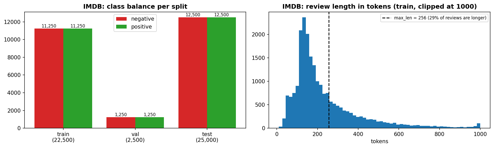
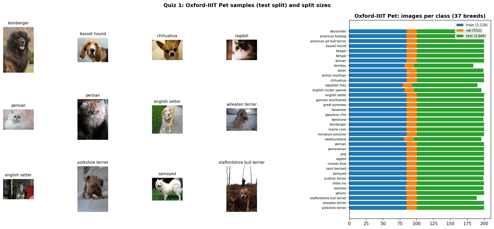
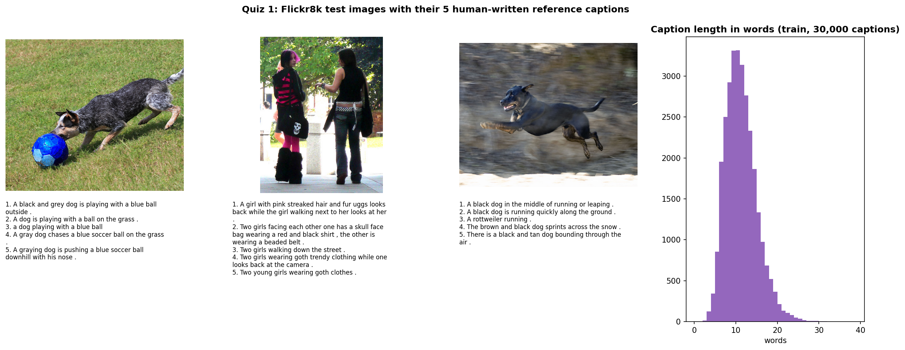

---

## Quiz 2：Sentiment Analysis（基礎 10 分 + 進階 10 分）

### 1. 設計
兩個模型**除了循環單元之外完全相同**，比較結果才能歸因於 RNN 與 LSTM 本身。

| 項目 | 設定 |
| :--- | :--- |
| 前處理 | 小寫、去除 `<br />`、以字詞切分；詞彙表取訓練集出現 ≥ 2 次的前 20,000 字（加上 `<pad>`、`<unk>` 共 20,002） |
| 序列長度 | 每則評論保留**最後 256 個 token**（評論的總結評價通常在結尾）；以 packed sequence 讓循環停在真實長度，最後的 hidden state 不受 padding 影響 |
| 架構 | Embedding(128) → 單層 `nn.RNN`（tanh）或 `nn.LSTM`(128) → Dropout(0.3) → Linear(2) |
| 訓練 | Adam（lr 1e-3；程式中以 weight decay = 0 的 AdamW 實作，與 Adam 等價）、batch 64、10 epochs、梯度裁剪 1.0；保留 Validation Accuracy 最高的 epoch |

### 2. 基礎：RNN 訓練與測試資料推論

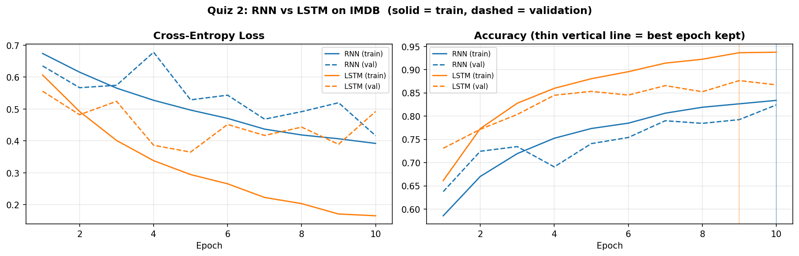

- RNN 共 2,593,538 個參數，訓練 10 個 epoch（0.95 分鐘），最佳 epoch 為第 10 個（Validation Accuracy 0.824）。Validation Loss 雖然有起伏（第 4 個 epoch 從 0.57 跳到 0.68），但整體由 0.63 降到 0.42，第 10 個 epoch 的 Loss 最低、Accuracy 最高，代表 RNN 在 10 個 epoch 內還沒有完全收斂。
- **測試集（25,000 則）**：Accuracy **0.8172**、F1 **0.8223**、ROC-AUC **0.8924**。逐則預測結果存於 `Output/quiz2_test_predictions.csv`。

### 3. 推論結果範例（`Output/quiz2_inference_examples.csv`）

| 來源 | 評論（節錄） | 真實 | RNN | LSTM |
| :--- | :--- | :---: | :---: | :---: |
| test #21259 | This movie is a masterpiece of brilliant acting… | positive | positive (0.96) | positive (1.00) |
| test #1880 | Anatomie isn't very unique in horror genre… | negative | negative (0.97) | negative (1.00) |
| test #7694 | This appears to be one of Noel Coward's lesser known films… | negative | ✗ positive (0.93) | ✗ positive (0.74) |
| test #1024 | Let me first start with the obvious: antisemitism… | negative | negative (0.83) | ✗ positive (0.93) |
| 自行撰寫 | A complete waste of time. The plot made no sense… | negative | negative (0.95) | negative (1.00) |
| 自行撰寫 | I expected to hate this film, but by the end I was completely won over. | positive | ✗ negative (0.76) | ✗ negative (0.68) |
| 自行撰寫 | The first half is great, but the ending ruins everything… | negative | ✗ positive (0.66) | ✗ positive (0.85) |

（完整 12 則見 CSV：8 則隨機測試評論中 RNN 答對 7 則、LSTM 答對 6 則。）

- 兩個模型對語氣直接的評論都能正確判斷；但兩句「先抑後揚 / 先揚後抑」的自寫評論兩個模型都判錯，推測模型主要依賴 `hate`、`great` 這類情緒詞，還無法正確處理 `but` 之後的語意轉折。

### 4. 進階：LSTM 與 RNN 的比較

| 模型 | 參數量 | 最佳 epoch | Val Acc | **Test Accuracy** | Precision | Recall | **F1** | **ROC-AUC** |
| :--- | ---: | :---: | :---: | :---: | :---: | :---: | :---: | :---: |
| RNN | 2,593,538 | 10 / 10 | 0.8240 | 0.8172 | 0.8002 | 0.8457 | 0.8223 | 0.8924 |
| LSTM | 2,692,610 | 9 / 10 | 0.8764 | **0.8805** | **0.8772** | **0.8848** | **0.8810** | **0.9466** |

**依評論長度分組的 Test Accuracy**

| 評論長度（token） | 則數 | RNN | LSTM | 差距 |
| :--- | ---: | :---: | :---: | :---: |
| ≤ 128 | 6,673 | 0.8464 | 0.8897 | +4.3 |
| 129–256 | 11,347 | 0.8119 | 0.8863 | +7.4 |
| > 256（截斷為最後 256 個） | 6,980 | 0.7980 | 0.8622 | +6.4 |

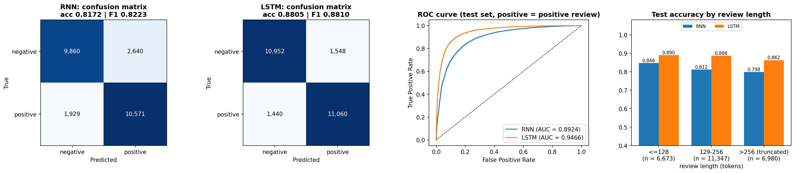

**指標選擇**：IMDB 正負樣本各半，Accuracy 有意義；另外用 Precision / Recall / F1 看兩類錯誤是否平衡，用 ROC-AUC 評估不依賴 0.5 門檻的排序能力，並用「依長度分組」直接檢驗兩者處理長序列的差異。

**觀察**
- **LSTM 在所有指標都比 RNN 好**：Accuracy 高 6.3 個百分點、ROC-AUC 高 0.054，而參數只多 3.8%（99,072 個）。
- **RNN 的錯誤偏向把負評判成正評**：RNN 有 2,640 則負評被判為正評、1,929 則正評被判為負評；LSTM 兩種錯誤幾乎相同（1,548 / 1,440），判斷比較平衡。
- **序列越長，RNN 掉得越多**：評論從 ≤ 128 個 token 變成 129–256 個 token 時，RNN 的 Accuracy 下降 3.5 個百分點（0.8464 → 0.8119），LSTM 幾乎不變（0.8897 → 0.8863）。這符合課程內容：RNN 的梯度在長序列上反覆相乘容易消失，較早的資訊很難影響最後的 hidden state；LSTM 透過 cell state 與 forget / input / output gate 讓資訊可以跨越較長的距離保留下來。超過 256 個 token 的評論只保留最後 256 個，兩個模型讀到的長度相同，但都因為看不到評論前段而再下降一些（RNN 0.7980、LSTM 0.8622）。
- **LSTM 出現過擬合的徵兆**：LSTM 的 Train Loss 持續降到 0.17，但 Validation Loss 在第 5 個 epoch 最低（0.365）之後回升；Validation Accuracy 則在第 9 個 epoch 才達到最高（0.8764）。Loss 回升但 Accuracy 沒有下降，通常代表模型對部分答錯的樣本越來越有信心。程式依 Validation Accuracy 保留第 9 個 epoch 的權重。

---

## Quiz 3：Vision Transformer（基礎 20 分 + 進階 15 分）

### 1. 設計
兩個模型都載入 ImageNet 預訓練權重、換成 37 類輸出層後**全部微調**，訓練設定完全相同；兩組預訓練權重在 ImageNet-1k 上的準確率幾乎一樣，比較的起點公平。

| 項目 | ViT-B/16 | ResNet-50 |
| :--- | :--- | :--- |
| 預訓練權重 | torchvision `IMAGENET1K_V1`（ImageNet-1k Top-1 81.07%） | torchvision `IMAGENET1K_V2`（ImageNet-1k Top-1 80.86%） |
| 參數量 | 85,827,109 | 23,583,845 |
| 訓練 | AdamW（lr 1e-4、weight decay 0.05）、1 epoch warm-up + cosine、batch 32、8 epochs、混合精度 | 同左 |
| 資料擴增 | RandomResizedCrop(224, scale 0.6–1.0)、水平翻轉；驗證 / 測試：Resize 256 → CenterCrop 224 | 同左 |

### 2. 基礎：微調 ViT 與推論結果

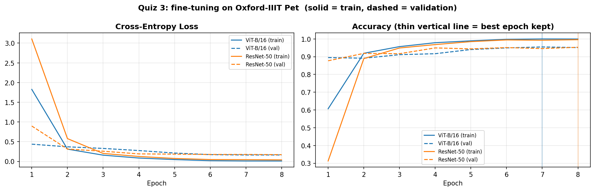

- ViT-B/16 在第 1 個 epoch 結束時 Validation Accuracy 就達到 0.895，代表 ImageNet 預訓練的特徵對貓狗品種已經很有用；第 7 個 epoch 達到最佳（0.9547）。
- **測試集（3,669 張）**：Top-1 **0.9305**、Top-5 **0.9954**、Macro-AUC **0.998246**。逐張預測存於 `Output/quiz3_test_predictions.csv`。

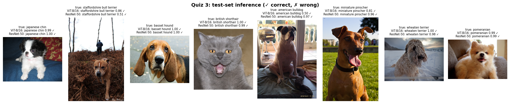

### 3. 進階：微調 ResNet 並與 ViT 比較 Macro-AUC

| 模型 | 參數量 | 最佳 epoch | Val Acc | **Test Top-1** | Test Top-5 | **Macro-AUC** | 訓練時間 | 推論速度 |
| :--- | ---: | :---: | :---: | :---: | :---: | :---: | :---: | :---: |
| ViT-B/16 | 85,827,109 | 7 / 8 | 0.9547 | **0.9305** | 0.9954 | **0.998246** | 5.8 分 | 160 張/秒 |
| ResNet-50 | 23,583,845 | 8 / 8 | 0.9529 | 0.9275 | 0.9956 | 0.998185 | 3.0 分 | 187 張/秒 |

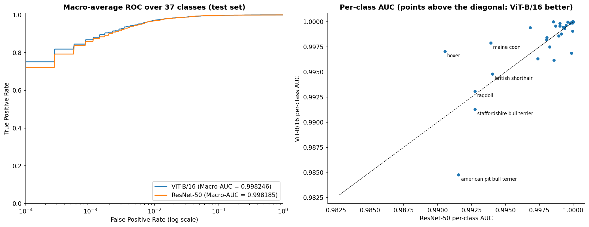

**觀察**
- **Macro-AUC 兩者幾乎相同**：ViT 0.998246、ResNet 0.998185，只差 0.00006；37 個類別中 ViT 的 AUC 較高的有 20 類、ResNet 較高的有 16 類（1 類相同），沒有一個模型全面勝出。兩者的 Macro-AUC 都接近 1，表示兩個模型對每個品種的機率排序都非常好，差異主要在少數外觀相近的品種。
- **Top-1 ViT 略高 0.3 個百分點**（錯 255 張 vs 266 張），但 ViT 的參數是 ResNet 的 3.6 倍、訓練時間是 1.9 倍、推論較慢。
- **錯誤集中在外觀相近的品種**：兩個模型最常見的錯誤都是 american pit bull terrier → staffordshire bull terrier（ViT 21 張、ResNet 28 張），其次是 egyptian mau ↔ bengal、ragdoll ↔ birman；有 155 張影像兩個模型都判錯。american pit bull terrier 是兩個模型都最差的類別（Accuracy 0.58 / 0.57）。
- **與課程內容的對照**：ViT 沒有 CNN 的局部性（locality）與平移等變性（translation equivariance）等歸納偏置，需要更大量的預訓練資料才能明顯勝過 CNN（Dosovitskiy et al., 2021）。本作業的 ViT-B/16 只在 ImageNet-1k 上預訓練，在這個條件下與 ResNet-50 表現相當，與論文的觀察一致。

---

## Quiz 4：Image Captioning（基礎 20 分 + 進階 15 分）

### 1. 設計
**自行訓練的兩個描述模型**：影像編碼器都是**凍結的 ImageNet ResNet-50**（23,508,032 個參數，不訓練），把整張照片縮放為 224×224 後取最後一層卷積的 7×7 = 49 個區域特徵（2048 維）。

| 模型 | 解碼器 | 可訓練參數 |
| :--- | :--- | ---: |
| **CNN-LSTM**（類似 Show and Tell，Vinyals et al., 2015） | 49 個區域特徵平均後初始化 LSTM 的 hidden / cell state，LSTM(512) 逐字產生描述 | 6,795,749 |
| **CNN-Transformer** | 3 層 Transformer Decoder（d = 512、8 heads）：Masked Self-Attention 看已產生的字，Cross-Attention 看 49 個影像區域 | 16,316,389 |

- 詞彙表：訓練描述中出現 ≥ 5 次的字（2,533 個，含 4 個特殊符號）；描述最長 30 個字。
- 訓練：Teacher forcing、Cross-Entropy、AdamW（lr 3e-4）、warm-up + cosine、batch 128、15 epochs；保留 **Validation BLEU-4** 最高的 epoch。

**比較的六種方法**
| 方法 | 說明 |
| :--- | :--- |
| LSTM greedy / LSTM beam3 | 自行訓練的 CNN-LSTM，每步取機率最高的字 / Beam Search (k = 3) |
| Transformer greedy / Transformer beam3 | 自行訓練的 CNN-Transformer，同上 |
| BLIP-base | `Salesforce/blip-image-captioning-base` 預訓練模型（已在 COCO 描述資料上訓練），**沒有在 Flickr8k 上訓練**（zero-shot） |
| Gemini | `gemini-3.5-flash-lite` 直接看圖寫一句描述 |

### 2. 基礎：訓練描述模型並產生描述

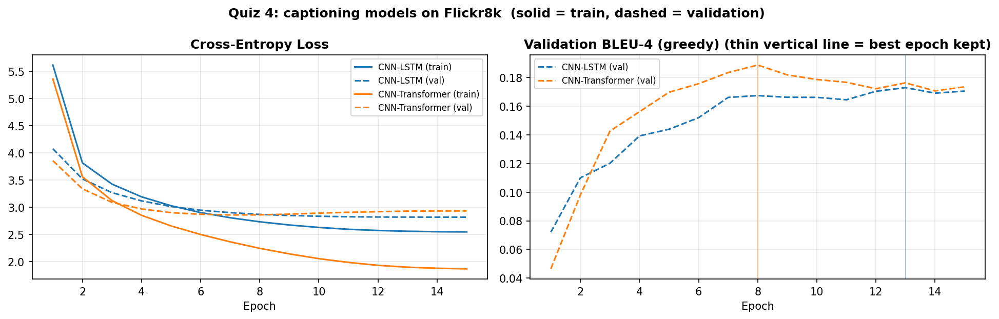

| 模型 | 最佳 epoch | Val BLEU-4（greedy） | 訓練時間 |
| :--- | :---: | :---: | :---: |
| CNN-LSTM | 13 / 15 | 0.1729 | 1.8 分 |
| CNN-Transformer | 8 / 15 | 0.1886 | 9.9 分 |

- 兩個模型都成功學會產生通順的描述（例如 `a black dog is running through the water`）。CNN-Transformer 學得較快，但 Validation Loss 在第 7 個 epoch 最低（2.855）之後回升、Validation BLEU-4 在第 8 個 epoch 達到最高（0.1886）之後下降，開始過擬合（Train Loss 最後降到 1.86，LSTM 為 2.54）；依 Validation BLEU-4 挑選權重，所以保留的是第 8 個 epoch。CNN-LSTM 則一路緩慢進步，沒有明顯過擬合。
- 1,000 張測試影像的所有描述存於 `Output/quiz4_test_captions.csv`。

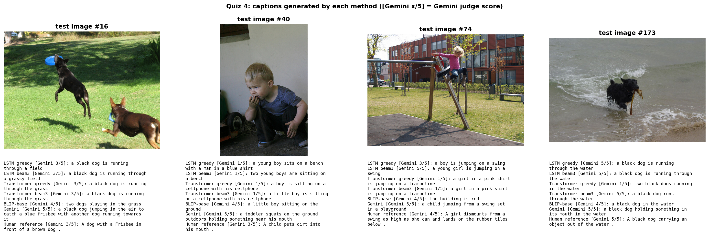

### 3. 基礎：Gemini 判斷描述是否符合影像

**做法**：從測試集以固定亂數種子隨機抽出 20 張影像。每張影像把六種方法的描述，再加上一句人工描述（對照組），**打亂順序並以 A、B、C… 匿名**後一次送給 Gemini，請它對每一句判斷 match（完全正確）/ partial（主體正確但細節有誤）/ mismatch（主體或動作錯誤），並給 1–5 分與理由。Gemini 只看到字母，不知道描述來自哪個方法。每一句的判斷與理由存於 `Output/quiz4_gemini_judgements.csv`（20 張 × 7 句 = 140 筆）。

| 方法 | Gemini 平均分數（1–5） | match | partial | mismatch |
| :--- | :---: | :---: | :---: | :---: |
| LSTM greedy | 2.80 | 35% | 20% | 45% |
| LSTM beam3 | 3.00 | 40% | 20% | 40% |
| Transformer greedy | 2.55 | 30% | 20% | 50% |
| Transformer beam3 | 2.90 | 35% | 20% | 45% |
| BLIP-base | 3.50 | 55% | 30% | 15% |
| Gemini | 5.00 | 100% | 0% | 0% |
| 人工描述（對照組） | 4.55 | 80% | 15% | 5% |

**觀察**
- **自行訓練的模型約 30–40% 完全正確**：通常能抓到主體（狗、男人、小孩），但細節常出錯，例如 #74 小孩從鞦韆上跳下，Transformer 卻說是 `jumping on a trampoline`；#40 小孩把東西放進嘴裡，Transformer 卻說 `sitting on a cellphone`；#173 只有一隻狗，Transformer greedy 卻說 `two black dogs`（見上方範例圖）。Beam Search 讓兩個模型的平均分數都提高（LSTM 2.80 → 3.00、Transformer 2.55 → 2.90）。
- **對照組驗證了評審的合理性**：人工描述 80% 被判為 match，代表 Gemini 的判斷大致可信，而且評分偏嚴格：沒被判為 match 的 4 句人工描述都是細節與照片不完全一致，例如 #40「小孩把泥土放進嘴裡」被判 partial（理由：無法確認是泥土）、#834 把白色的鳥描述成「灰白色」被判 mismatch。
- **Gemini 對自己寫的描述全部給 5 分**，比人工描述還高。Gemini 的描述確實較詳細，但這也可能包含評審對自己生成風格的偏好，因此這一列不應直接解讀為「Gemini 比人工描述好」（見限制與說明）。

### 4. 進階：BLEU 與 BERTScore（完整測試集）

所有描述先做相同正規化（小寫、只保留英文單字），再與每張影像的 5 句人工描述比較。BLEU 為 corpus BLEU；BERTScore 使用 RoBERTa-large 並以官方 baseline rescale，取 5 句參考中最相近者。

| 方法（1,000 張測試影像） | BLEU-1 | BLEU-2 | BLEU-3 | **BLEU-4** | **BERTScore F1** |
| :--- | :---: | :---: | :---: | :---: | :---: |
| LSTM greedy | 0.5866 | 0.4127 | 0.2787 | 0.1866 | 0.5680 |
| LSTM beam3 | 0.6183 | 0.4414 | 0.3077 | 0.2119 | 0.5838 |
| Transformer greedy | 0.5847 | 0.4091 | 0.2784 | 0.1882 | 0.5621 |
| Transformer beam3 | 0.6164 | 0.4373 | 0.3053 | 0.2087 | 0.5803 |
| BLIP-base（zero-shot） | **0.6420** | **0.4910** | **0.3636** | **0.2672** | **0.6067** |

- **Beam Search 一致提升表現**：兩個模型的 BLEU-4 都提高約 2–2.5 個百分點、BERTScore 提高約 0.016–0.018。Greedy 每一步只選當下機率最高的字，容易陷入重複（例如測試影像 #15 的 Transformer greedy 描述 `... standing in front of a crowd of a crowd of a crowd of ...`，見 `Output/quiz4_test_captions.csv`）；Beam Search 同時保留 3 個候選句並以長度正規化的總機率挑選，句子較完整。
- **LSTM 與 Transformer 表現相當**：Beam Search 下 BLEU-4 分別為 0.2119 與 0.2087。Transformer 的參數是 LSTM 的 2.4 倍，在只有 6,000 張訓練影像的情況下第 8 個 epoch 之後就開始過擬合（見第 2 節），推測這是它沒有明顯勝過 LSTM 的原因。
- **BLIP 雖然沒有在 Flickr8k 上訓練，所有指標仍最好**：它在大規模影像－文字資料上預訓練並在 COCO 上訓練過描述任務，顯示預訓練資料規模的重要性，與 Quiz 3 的觀察一致。

### 5. 進階：不同方法的回覆時間與表現比較

**回覆時間**：在 Gemini 判斷用的同一批 20 張測試影像上，逐張量測「從影像到描述」的端對端時間（batch size 1；正式計時前先用 3 張影像暖機，暖機不計時，之後 20 張全部計時）。本地方法在 Colab T4 上執行，且包含 ResNet-50 特徵擷取；Gemini 為 API 來回時間（含網路延遲）。

| 方法（同 20 張影像） | 平均時間 | 中位數時間 | BLEU-4 | BERTScore F1 | Gemini 平均分數 | Gemini match |
| :--- | ---: | ---: | :---: | :---: | :---: | :---: |
| LSTM greedy | **17.7 ms** | **17.4 ms** | 0.2024 | 0.5819 | 2.80 | 35% |
| LSTM beam3 | 18.3 ms | 17.9 ms | 0.1237 | 0.5888 | 3.00 | 40% |
| Transformer greedy | 48.6 ms | 45.3 ms | 0.2127 | 0.5933 | 2.55 | 30% |
| Transformer beam3 | 58.0 ms | 56.8 ms | **0.2419** | **0.5961** | 2.90 | 35% |
| BLIP-base | 205.4 ms | 206.0 ms | 0.2310 | 0.5554 | 3.50 | 55% |
| Gemini（`gemini-3.5-flash-lite`） | 3,588 ms | 2,069 ms | 0.1645 | 0.5842 | **5.00** | **100%** |

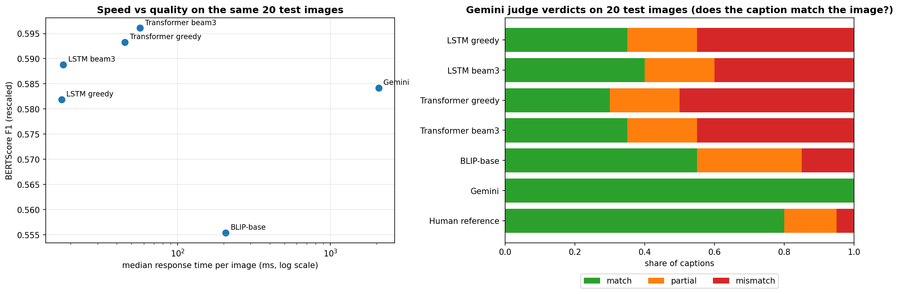

**觀察**
- **速度差距超過兩個數量級**：LSTM 每張約 18 ms，Transformer 約 45–57 ms（解碼時每產生一個字都重新計算整個句子，沒有使用 KV cache），BLIP 約 206 ms，Gemini 中位數約 2.1 秒、平均 3.6 秒（最慢一次 18.3 秒，受網路與伺服器負載影響，波動很大）。Gemini 比自行訓練的 LSTM 慢約 120 倍。
- **品質排序依指標而不同**：
  - 以 Gemini 判斷（最接近「描述是否正確」）：Gemini > BLIP > 自行訓練的模型。
  - 以 BLEU / BERTScore：自行訓練的模型在這 20 張上與 Gemini 相近甚至更高。BLEU 只計算與參考描述共同的 n-gram，自行訓練的模型學的就是 Flickr8k 的句型（`a black dog is running through ...`），所以容易得分；Gemini 的描述較詳細、用字不同（`a black dog holding something in its mouth in the water`），即使內容正確，BLEU 也偏低。這說明 n-gram 指標衡量的是「像不像參考描述」，不完全等於「描述是否正確」，因此本作業同時使用 Gemini 判斷作為補充。
- **只有 20 張時 BLEU-4 的變異很大**：例如 LSTM beam3 在這 20 張上 BLEU-4 只有 0.1237，比 greedy 低，但在完整 1,000 張上 beam3 明顯較好（0.2119 vs 0.1866）；BLIP 的 BERTScore 在這 20 張上最低，但在 1,000 張上最高。因此方法之間的表現比較以第 4 節的完整測試集為準，這張表主要用來比較回覆時間與 Gemini 判斷。
- **實務上的取捨**：需要即時、大量、離線處理時，自行訓練的 CNN-LSTM 最快、成本最低、可在本地執行；BLIP 在速度與品質之間取得平衡；Gemini 的描述最詳細、評審得分最高，但每張需要數秒、受 API 額度限制（本作業實際遇到），且需要網路。

---

## 限制與說明
1. **Gemini 相關結果只用 20 張測試影像**：原本設計為 50 張（共 100 次 API 呼叫），但免費 API 額度不足：程式原本自動選用的最新模型 `gemini-3.8-flash`，以及之後改用的 `gemini-3.5-flash`，都持續回傳 503（伺服器忙碌）與 429（超過額度）。因此改用 `gemini-3.5-flash-lite`，並把影像降為 20 張（共 40 次呼叫），在免費額度內完成。Gemini 寫描述與評審都使用同一個模型，結果彼此可比較。20 張影像以固定亂數種子隨機抽出、不是人工挑選，但結果只能視為趨勢；BLEU / BERTScore 的完整評估在 1,000 張測試影像上進行。
2. **評審偏差**：Gemini 同時是被比較的方法之一與評審，對自己生成的描述可能有偏好（自己的描述全部 5 分，高於人工描述的 4.55 分）。評審時已採匿名、隨機順序，並加入人工描述作為對照組。
3. **單次訓練**：每組實驗只訓練一次（seed = 42），差距很小的比較（例如 ViT 與 ResNet 的 Macro-AUC 差 0.00006）不能視為顯著差異。
4. **相同的訓練預算**：RNN 與 LSTM 都訓練 10 個 epoch；RNN 的 Validation Accuracy 到第 10 個 epoch 仍在上升，延長訓練可能縮小兩者的差距；但在長序列上的劣勢，與 RNN 本身的結構（梯度消失）有關，不只是訓練不足。
5. **回覆時間的條件**：本地方法在 Colab T4 GPU 上量測；Gemini 的時間包含網路延遲與伺服器排隊時間，換時段或網路環境會不同。
