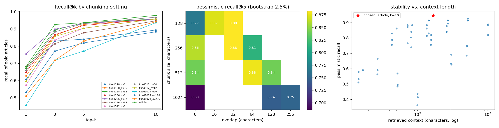
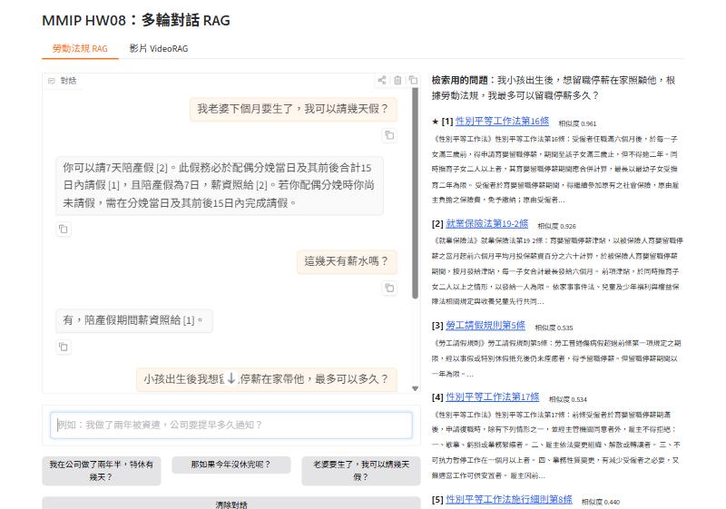
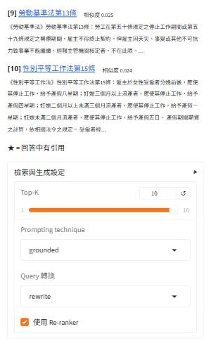
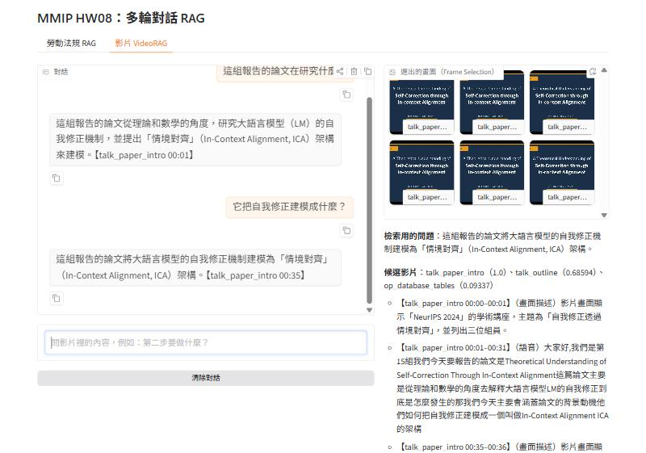
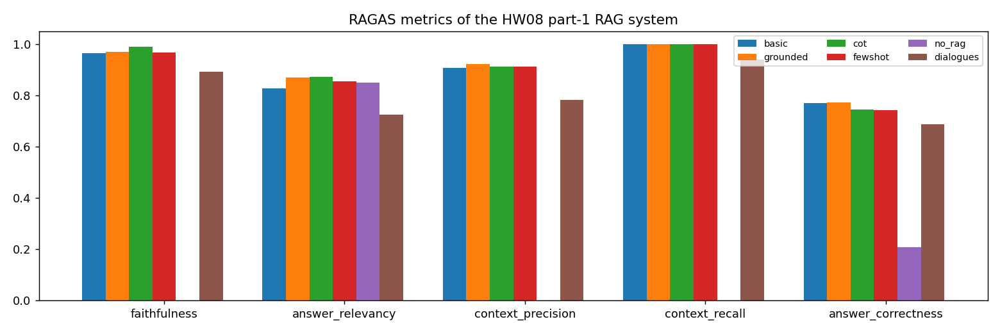
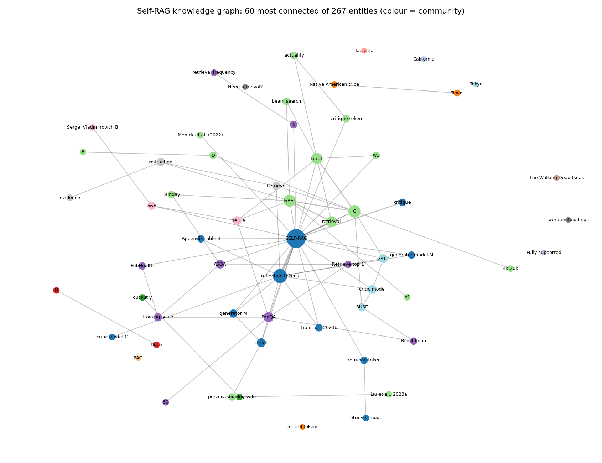

# 國立陽明交通大學 多模態影像資料處理 (MMIP) 作業八技術報告
## 檢索增強生成（RAG）：多輪對話 RAG、VideoRAG、RAGAS 評估、GraphRAG

- **學生**：林孟霆（`315833033`）
- **規範依據**：課程投影片 `多模態影像資料處理（MMIP）第十堂_檢索增強生成（RAG）` 第 72–75 頁
- **配分**：作業一（基礎 15 + 進階 15）、作業二（基礎 15）、作業三（基礎 10 + 進階 10）、作業四（基礎 20）
- **模型**：bge-m3（embedding）、bge-reranker-v2-m3、Qwen3-4B-Instruct-2507（生成）、Whisper large-v3-turbo、Chinese-CLIP、Qwen3-VL-2B（影片）；評審 `gemini-3.5-flash-lite`
- **執行**：Google Colab T4，2026-11-22

> [!NOTE]
> **給助教的導覽**：
> - **文字報告**：本 `README.md`。
> - **執行紀錄**：`HW08_notebook_executed.ipynb`（Colab 實際執行、含輸出，報告中的數字都來自這次執行）；`HW08_notebook.ipynb` 是目前程式碼的版本（之後修正的部分見各節說明），可直接重跑。
> - **結果檔**：`Output/`（表格、圖、所有回答與評審快取）；**介面截圖**：`figures/`。
> - **資料**：`Data/laws.json`（14 部勞動法規 842 條）、`Data/rag_eval.json`（手寫 47 題 + 11 段多輪對話）、`Data/selfrag.txt` 與 `Data/graph_benchmark.json`（作業四論文與 25 題 Benchmark）、`Data/videos/`（錄製說明；影片檔不上傳）、`Data/video_qa.json`（影片問答與時間標註）。
> - **AI 協作紀錄**：`AI/AI_collaboration_log.md`。

### 評分項目對照表

| 題目（配分） | 規範要求 | 本作業做法與主要結果 | 文字 | 程式 / 結果檔 |
| :--- | :--- | :--- | :--- | :--- |
| 作業一 基礎（5） | 自製特定主題的 QA Dataset，Embedding 數量達標 | 台灣勞動法規 842 條；LLM 為每條產生 5W1H 問題（1,794 題）＋手寫 47 題問答＋11 段多輪對話；共 **2,636 個 embedding** | [1-1](#1-1-qa-dataset-與-embedding) | `Code/hw1.py`、`Output/hw1_qa_dataset.json` |
| 作業一 基礎（10） | 多輪對話經 RAG 後獲得合理回覆與 Reference | Query 改寫 → 檢索 → Re-ranker → 附 [n] 引用的回答，引用對應條號與官方連結；33 輪對話中 **94%** 檢索到正確條文、**88%** 引用正確條文 | [1-2](#1-2-多輪對話) | `Output/hw1_dialogues_k10_noq_rr.json` |
| 作業一 進階（5） | 最穩定的 Chunk Size、Overlap、Top-K | 13 種切塊 × 4 種 Top-K × 正式 / 口語問法，以 bootstrap 下界選擇：**一條一塊、Top-10**（Recall 0.979，下界 0.947） | [1-3](#1-3-chunk-size--overlap--top-k) | `Output/hw1_grid.csv`、`hw1_grid.png`、`hw1_ablation.csv` |
| 作業一 進階（5） | 最合適的 Prompting Technique | 4 種 Prompt 以 RAGAS 比較：**grounded** 正確性最高（0.772）且 96% 回答有引用 | [1-4](#1-4-prompting-technique) | `Output/hw3_ragas_summary.csv` |
| 作業一 進階（5） | 合適的 User Interface | Gradio：顯示改寫後的檢索問題、引用條文（★）與官方連結、可即時調整設定；影片分頁顯示選出的畫面 | [1-5](#1-5-使用者介面) | `Code/ui.py`、`figures/` |
| 作業二 基礎（5） | 自行錄製有說話與沒有說話的影片 | 自己的論文報告錄影（有說話）與期末專題操作錄影（沒有聲音）剪成 5 支短片 | [2-1](#2-1-video-corpus) | `Data/videos/README.md` |
| 作業二 基礎（10） | 參考 VideoRAG 實踐多輪對話 RAG 聊天機器人 | Whisper + 每秒一張代表畫面 + 畫面描述；跨模態影片檢索；40 組子集的 Frame Selection；Qwen3-VL 回答附【影片 mm:ss】 | [2-2](#2-2-videorag-設計) | `Code/video.py` |
| 作業三 基礎（10） | 以 RAGAS / ARES 評估作業一 | RAGAS 5 個指標；RAG 正確性 0.772 vs 不檢索 0.208；Gemini 與本地評審一致性 | [3-1](#3-1-ragas-評估作業一) | `Code/ragas_eval.py`、`Output/hw3_*` |
| 作業三 進階（10） | 延伸評估 VideoRAG | 影片檢索、時間定位、多模態 RAGAS（評審直接看畫面）、模態與 Frame Selection 消融 | [3-2](#3-2-videorag-評估) | `Code/video_eval.py`、`Output/hw3_video_*` |
| 作業四 基礎（5） | 選一篇 AI 論文並 Graph 化 | Self-RAG：LLM 抽取實體與關係 → 知識圖 → Louvain 社群報告 | [4-1](#4-1-graph-化) | `Code/graphrag.py`、`Output/hw4_graph.*` |
| 作業四 基礎（5） | ≥ 20 題 Benchmark | 25 題（local 14、multi-hop 7、global 4），每題列關鍵要點 | [4-2](#4-2-benchmark) | `Data/graph_benchmark.json` |
| 作業四 基礎（10） | 實踐 GraphRAG 並評估 | local / global / 路由式 GraphRAG vs 向量 RAG；GraphRAG 在這次執行輸給向量 RAG，分析原因並修正（v2） | [4-3](#4-3-結果與分析) | `Output/hw4_*.csv` |

---

## 作業一：多輪對話 RAG

### 1-1 QA Dataset 與 Embedding
- **主題**：台灣勞動法規。從全國法規資料庫下載 14 部法規（勞動基準法與施行細則、勞工請假規則、性別平等工作法與施行細則、勞工退休金條例、最低工資法、職業安全衛生法、就業服務法、勞資爭議處理法、工會法、勞工保險條例、就業保險法、勞工職業災害保險及保護法），共 842 條、約 12.3 萬字（2026-11-11 下載的現行條文；例如勞工請假規則第 2 條已修正為婚假 14 日）。法規不受著作權保護（著作權法第 9 條）。
- **QA Dataset**（`Output/hw1_qa_dataset.json`）：
  1. 依投影片第 12 頁，用 Qwen3-4B 替每個 chunk 產生最多 3 個 5W1H 問題（含口語問法），去除重複後共 **1,794 題**。例如勞動基準法第 2 條 →「誰可以被稱為勞工？」「如果我工作了五個月，怎麼算我的平均工資？」。
  2. 手寫 **47 題**單輪問答，每題附一個口語問法、標準答案與正確條文，例如「我是勞退新制，被資遣可以拿多少資遣費？」→ 勞工退休金條例第 12 條。
  3. 手寫 **11 段 × 3 輪**的多輪對話，第 2、3 輪大多需要上下文才能理解（例如「那休息日呢？」）。
- **Embedding 數量**：投影片上的目標數字是空白。本作業的索引有 842 個 chunk + 1,794 個合成問題 = **2,636 個 embedding**（bge-m3，1,024 維）。
- 手寫題目與對話只用於評估，不進入索引。

### 1-2 多輪對話
**流程**：
1. 有對話紀錄時，Qwen3-4B 依紀錄把問題改寫成可獨立理解的問題（例如「這幾天公司要付薪水嗎？」→「我請假照顧母親，因為她住院了，這幾天公司需要支付我的薪水嗎？」）。
2. bge-m3 檢索前 20 名，bge-reranker-v2-m3 重新排序後取前 10 名。
3. Qwen3-4B 依 Prompt 回答，並以 [n] 標示出處。
4. [n] 對應到條號與全國法規資料庫的連結。

**結果**：33 輪對話中，**94%** 檢索到正確條文、**88%** 的回答引用了正確條文；RAGAS 正確性 0.686，見 [3-1](#3-1-ragas-評估作業一)。以下是 Notebook 輸出的一段對話（M09）：

| 輪 | 使用者 | 改寫後的檢索問題 | 系統回答（節錄） | 引用 |
| :--- | :--- | :--- | :--- | :--- |
| 1 | 我媽媽住院了，我需要請假照顧她 | （第一輪不改寫） | 可請事假照顧母親…若符合性別平等工作法第 20 條，可請家庭照顧假，併入事假計算，全年以七日為限 [6] | ★勞工請假規則第 7 條、★性別平等工作法第 20 條 |
| 2 | 這幾天公司要付薪水嗎？ | 我請假照顧母親，因為她住院了，這幾天公司需要支付我的薪水嗎？ | 事假期間不給薪資；家庭照顧假薪資依事假規定 [5] | ★同上 |
| 3 | 可以用小時為單位來請嗎？ | 我可以請假的時間單位是小時嗎？ | 可以，依勞工請假規則第 7 條得擇定以小時為請假單位 [1] | ★勞工請假規則第 7 條 |

**錯誤分析**：多數錯誤不是檢索失敗，而是 4B 模型讀錯條文。
- M01：「做了兩年半，特休有幾天？」勞動基準法第 38 條排在第 1 名（分數 0.85），模型卻答成「一年以上二年未滿，7 日」，正確是二年以上三年未滿 10 日。
- M04：資遣費的公式正確（每滿一年發給二分之一個月平均工資），但接著把兩年年資算成「一年半平均工資」，正確是 1 個月。

這類錯誤在 RAGAS 中表現為 faithfulness 高但 answer correctness 低。

**對話紀錄的長度**：改寫問題時參考最近 3 輪（每則回答截到 200 字），生成回答時帶入最近 2 輪。對 3 輪的評估對話足夠；更長的對話需要摘要記憶。

### 1-3 Chunk Size / Overlap / Top-K
**設定範圍**：
- 固定長度切塊：128 / 256 / 512 / 1024 字 × overlap 0 / 12.5% / 25%，不跨法規；從條文中間開始的 chunk 會加上「《法規名》（第 X 條，續）」標頭。
- 一條一塊（article）。
- Top-K 1 / 3 / 5 / 10。
- 每題用正式與口語兩種問法。

**「最穩定」的定義**：
- 主要依據：bootstrap 重抽題目 1,000 次後 Recall@k 的 2.5 百分位數，代表壞情況下的表現。
- 輔助依據：正式 / 口語問法的差距（style gap）。
- 只考慮送進模型的檢索內容 ≤ 3,000 字的設定。

| 設定 | Top-K | 檢索內容（字） | Recall | Bootstrap 下界 | 正式 / 口語差距 |
| :--- | ---: | ---: | ---: | ---: | ---: |
| **article（一條一塊）** | **10** | 1,672 | **0.979** | **0.947** | **0.043** |
| fixed128_ov16 / ov32 | 10 | 1,445 | 0.957 | 0.915 | 0.085 |
| fixed256_ov0 | 10 | 2,695 | 0.957 | 0.915 | 0.043 |
| fixed128_ov0 | 10 | 1,441 | 0.894 | 0.830 | 0.043 |
| article | 5 | 836 | 0.936 | 0.883 | 0.128 |
| fixed512_ov64 | 5 | 2,595 | 0.931 | 0.878 | 0.138 |

**觀察**：
- 法條本身就是完整的語意單位（平均 167 字），一條一塊的召回與穩定度都最好。
- Overlap 對小 chunk 很重要：128 字從 overlap 0 加到 16，Recall@10 從 0.894 升到 0.957。但 overlap 不是越大越好，256 字 overlap 64 反而降到 0.947。
- Top-K 從 5 增加到 10，下界從 0.883 升到 0.947，口語問法的差距從 0.128 縮小到 0.043。Re-ranker 把正確條文排到前面，多出的 5 條主要用來保住口語問法的召回。
- 512 字以上的 chunk 在 Top-10 時超過 3,000 字的預算，不列入選擇。

**檢索消融**（article、Top-10，`Output/hw1_ablation.csv`）：

| 檢索方式 | Hit@1 | Recall@10 | MRR |
| :--- | ---: | ---: | ---: |
| 只有 chunk | 0.691 | 0.979 | 0.810 |
| ＋合成問題（Q 的 embedding） | 0.532 | 0.872 | 0.655 |
| **＋Re-ranker** | 0.755 | **1.000** | 0.846 |
| ＋兩者 | **0.798** | 0.936 | **0.856** |

- 合成問題單獨使用時反而變差。不少合成問題很籠統（例如「這條法規是誰要遵守的？」），用「chunk 或其問題取最高分」時，會把不相關的條文拉到前面。
- 加上 Re-ranker 後 Hit@1 最好，但 Recall@10 仍較低。
- Notebook 依 Recall@10（其次 MRR）自動選用「**只加 Re-ranker**」。

**第一次執行的差異**：第一次在 Colab 執行時，系統固定使用「兩者」。修正為依消融結果選擇後，作業一的回答與 RAGAS 都以新設定重算（`*_k10_noq_rr.json`）。舊結果保留為 `hw1_answers_{prompt}.json` 與 `hw1_dialogues.json`。兩次的 grounded 正確性分別是 0.780 與 0.772，context recall 從 0.957 升到 1.000。

**Query 轉換**（33 輪對話，Hit@10）：

| 方式 | 全部 | 第 1 輪 | 第 2–3 輪（需要上下文） |
| :--- | ---: | ---: | ---: |
| 不轉換 | 0.667 | 0.909 | 0.545 |
| **改寫成獨立問題（rewrite）** | 0.939 | 0.909 | 0.955 |
| 多重查詢（multi-query，RRF） | 0.970 | 1.000 | 0.955 |
| step-back | 0.939 | 0.909 | 0.955 |

- 多輪對話一定要做 Query 轉換：第 2–3 輪不轉換時只有 0.545。
- 三種轉換在需要上下文的輪次一樣好。multi-query 只多答對 1 題第 1 輪問題，但每輪要多生成 3 個查詢並檢索 3 次，系統預設用 rewrite（介面可切換）。

### 1-4 Prompting Technique
| 名稱 | 內容 |
| :--- | :--- |
| basic | 直接給檢索資料與問題 |
| grounded | 角色 + 只能依據資料 + 每個事實標 [n] + 資料不足就說明 + 先給結論、150 字內 |
| cot | grounded + 先「分析：」逐條判斷相關資料，再「答案：」 |
| fewshot | grounded + 一個示範問答 |

RAGAS 結果（47 題，Gemini 評審，詳見 [3-1](#3-1-ragas-評估作業一)）：

| Prompt | Faithfulness | Answer relevancy | Context precision | Answer correctness | 回答有引用正確條文 |
| :--- | ---: | ---: | ---: | ---: | ---: |
| basic | 0.964 | 0.827 | 0.907 | 0.770 | 2% |
| **grounded** | 0.970 | 0.869 | **0.922** | **0.772** | 96% |
| cot | **0.989** | **0.872** | 0.913 | 0.744 | **100%** |
| fewshot | 0.967 | 0.853 | 0.912 | 0.742 | 94% |

**結論：grounded 最合適。**
- 正確性與 context precision 最高，96% 的回答有可對照的引用。
- basic 的正確性幾乎相同，但只有 2% 的回答標出處，不符合「附 Reference」的要求。
- CoT 的 faithfulness 與引用率最高，但先寫分析使回答變長、正確性較低，生成時間也最長。
- few-shot 的示範讓回答格式趨同，對內容幫助不大。
- 四者的正確性差距在 0.03 以內，47 題中 1 題約 2 個百分點，差異不大。主要的差別在引用。

### 1-5 使用者介面
`Code/ui.py`（Gradio）一個介面兩個分頁：

- **勞動法規 RAG**：
  - 左側是對話。
  - 右側顯示系統實際用來檢索的問題（多輪改寫後）、檢索到的條文（★ = 回答中有引用；條號連到全國法規資料庫）與 Re-ranker 分數。
  - 可即時調整 Top-K、Prompt、Query 轉換、是否使用 Re-ranker。
- **影片 VideoRAG**：顯示 Frame Selection 選出的畫面（影片名稱與時間）、候選影片分數，以及使用的逐字稿 / 畫面描述。

| 檢索與生成設定 | VideoRAG 分頁 |
| :---: | :---: |
|  |  |

**截圖的來源**：
- 介面在 Colab 上以 `share=True` 啟動，並實際完成問答。但兩個分頁的模型同時在 GPU 上時 T4 記憶體不足，第二輪起回傳錯誤。
- 因此介面改成每個分頁回答前先卸載另一個分頁的模型。
- 截圖是在本機用同一份 `Code/ui.py` 啟動介面，回答直接讀取 Colab 執行時記錄的系統輸出（`Output/hw1_dialogues_k10_noq_rr.json` 的 M03、`Output/hw3_video_answers_v2.json` 的 VD02），沒有修改任何回答。

---

## 作業二：多輪對話 VideoRAG

### 2-1 Video Corpus
兩段先前自行錄製的影片，剪成 5 支短片（`Data/videos/`）。論文報告依投影片切開，demo 依操作階段切開：

| 來源（自行錄製） | 短片 | 長度 | 類型 | 內容 |
| :--- | :--- | ---: | :--- | :--- |
| 期末專題 Medical Assistant Model 的操作 demo（Chrome 螢幕錄影，原本就沒有聲音） | `op_patient_inference` | 19.5 s | 沒有說話 | 輸入病患姓名與 ID、上傳胸腔 X 光 DICOM、執行 YOLO → MedSAM → LLaVA-Med 推論 |
| | `op_review_report` | 30.1 s | 沒有說話 | 檢視氣胸偵測結果與 AI 草稿報告、改寫報告、填入審核醫師並送出 |
| | `op_database_tables` | 36.6 s | 沒有說話 | 在 Neon（PostgreSQL）主控台查看 ai_inference_results、patient_data、medical_reports 資料表 |
| 課堂論文報告 "A Theoretical Understanding of Self-Correction through In-context Alignment"（NeurIPS 2024；PowerPoint 放映錄影，有口頭講解） | `talk_paper_intro` | 36.1 s | 有說話 | 標題投影片：論文名稱、從理論與數學角度解釋 LLM 自我修正、報告涵蓋的內容 |
| | `talk_outline` | 44.5 s | 有說話 | Outline 投影片：motivation、From ICL to ICA、理論框架（BT / PL 模型、Softmax、Multi-head、FFN、Depth）、Synthetic Experiments |

**剪輯方式**：
- 操作 demo 原本就沒有聲音（音軌全為靜音），剪輯時直接移除音軌。
- 論文報告保留聲音，切點選在句子之間的停頓（依音量找出的靜音段）。開頭 8 秒的靜音與結尾一句重複的話被剪掉。
- 每張投影片的畫面在整段講解中幾乎不變，因此同一張投影片的段落合併成一支，不切成多支畫面相同的短片。

**限制**：影片總長約 3 分鐘，影片檔不提交到 GitHub。影片庫比一般 VideoRAG 小，影片檢索比較容易。三支操作影片是同一個網頁介面，畫面很相似，這是影片檢索主要的難點。

**索引**（`Output/video_index/`）：
- 兩支論文報告影片各得到 2 段 Whisper 語音片段。
- 每支影片每秒一張畫面；短片都不到 64 秒，所以全部畫面都是代表畫面，共 170 張。
- Qwen3-VL 為每張代表畫面寫一句描述。

### 2-2 VideoRAG 設計
| VideoRAG 原論文 | 本作業 |
| :--- | :--- |
| 以 InternVideo2 檢索影片 | 文字片段（Whisper 逐字稿 + VLM 畫面描述，bge-m3）與畫面（Chinese-CLIP）的相似度各自做 min-max 正規化後以 0.7 / 0.3 加權 |
| CLIP + K-means 取 64 張代表畫面 | 相同（每秒一張 → K-means → 最接近中心的畫面）；短於 64 秒的影片保留全部畫面 |
| 隨機 40 組 32 張子集，以訓練過的 3 層 MLP 評分 | 隨機 40 組 6 張子集（2B VLM 的輸入預算），以「子集平均 CLIP 向量 · 問題向量」＋ 與相符文字片段的時間接近度評分（沒有訓練資料，改為 zero-shot） |
| LVLM 生成 | Qwen3-VL-2B，回答附【影片 mm:ss】 |
| 單輪 | 多輪：先依對話紀錄改寫問題，並帶入最近兩輪對話 |

**設計細節**：
- **影片檢索的融合方式**：最初用排名融合（RRF），但只有 5 支影片時分數幾乎打平，常選錯影片。改為以相似度加權後才穩定。
- **沒有說話的影片**：操作影片沒有逐字稿，而 Whisper 在靜音段常「幻聽」出「謝謝觀看」之類的字。因此依音量與重複度濾掉靜音段的辨識結果，並以 VLM 的畫面描述作為「視覺逐字稿」。

**多輪 VideoRAG 對話**（`Output/hw3_video_answers_v2.json`）：

| 輪 | 使用者 | 系統回答（節錄） | 正確？ |
| :--- | :--- | :--- | :--- |
| VD02-1 | 這組報告的論文在研究什麼？ | 從理論和數學的角度研究 LLM 的自我修正，並以 In-Context Alignment（ICA）建模【talk_paper_intro 00:01】 | ✓ |
| VD02-2 | 它把自我修正建模成什麼？ | 建模為「情境對齊」（In-Context Alignment, ICA）架構【talk_paper_intro 00:35】 | ✓ |
| VD02-3 | 理論部分用到哪些模型？ | 重複了 ICA 的回答 | ✗（應為 BT / PL 模型，在 `talk_outline`） |
| 單題 V10 | 表單中輸入的病患姓名和病患 ID 是什麼？ | 病患姓名為 Russell Westbrook，病患 ID 為 0000【op_patient_inference 00:05】 | ✓（只能從畫面得知） |
| 單題 V16 | 雲端資料庫裡有哪些資料表？ | a_inference_results、medical_reports、patient_data、patient_visits【op_database_tables 00:15】 | 部分（第一個表名少了字母 i） |

---

## 作業三：評估 RAG 系統

### 3-1 RAGAS 評估作業一
**評估方式**：
- 依 RAGAS（Es et al., 2024）的定義實作 faithfulness、answer relevancy、context precision、context recall、answer correctness。
- 每筆回答只呼叫一次評審，同時回傳所有陳述與判斷，分數由程式計算。
- Answer relevancy 依定義由本地 Qwen3-4B 從回答反推問題，再用 bge-m3 算相似度。
- 評審是 Gemini。過程中多次遇到 Gemini 伺服器 503，程式會重試、失敗就跳過，之後重跑補齊。最後單題評審成功率 100%；no-RAG 為 45/47。

| 系統 | Faithfulness | Answer relevancy | Context precision | Context recall | Answer correctness |
| :--- | ---: | ---: | ---: | ---: | ---: |
| basic | 0.964 | 0.827 | 0.907 | 1.000 | 0.770 |
| grounded | 0.970 | 0.869 | 0.922 | 1.000 | 0.772 |
| cot | 0.989 | 0.872 | 0.913 | 1.000 | 0.744 |
| fewshot | 0.967 | 0.853 | 0.912 | 1.000 | 0.742 |
| 不檢索（同一模型直接回答） | — | 0.849 | — | — | **0.208** |
| 多輪對話（grounded，33 輪） | 0.892 | 0.725 | 0.782 | 0.939 | 0.686 |

**分析**：
- **RAG 的效果**：正確性從 0.208 升到 0.772。不檢索時模型會給出看似合理但錯誤的數字，例如婚假答成 3 日（現行 14 日）、平日加班費答成 1.5 倍、每月延長工時上限答成 36 小時（應為 46 小時）。這些回答的 answer relevancy 卻差不多（0.849），可見 relevancy 只代表「有回答到問題」。
- **Context recall = 1.000**：Top-10 加 Re-ranker 時每題都檢索到正確條文。剩下的錯誤都在生成端，也就是 faithfulness 高但 correctness 不到 0.8 的部分，例如 1-2 的特休天數。
- **多輪對話比單輪低**：context precision 0.782、answer relevancy 0.725。改寫後的問題偶爾帶入上一輪的主題，檢索到上一輪的條文並一起回答。例如「這幾天公司要付薪水嗎？」同時回答了事假與家庭照顧假。

**評審一致性**：Gemini 與本地 Qwen3-4B 評同一批 grounded 回答。

| 指標 | Gemini | 本地 Qwen3-4B | 平均絕對差 | Pearson r |
| :--- | ---: | ---: | ---: | ---: |
| faithfulness | 0.970 | 0.898 | 0.093 | 0.29 |
| context precision | 0.922 | 0.948 | 0.066 | 0.65 |
| context recall | 1.000 | 0.989 | 0.011 | — |
| answer correctness | 0.772 | 0.895 | 0.177 | 0.51 |

本地 4B 評審對正確性寬鬆得多（+0.12），與 Gemini 只有中度相關，所以報告的數字都用 Gemini。這也說明 RAGAS 分數依賴評審模型，不同評審的分數不能直接比較。

### 3-2 VideoRAG 評估
**為什麼要另外設計指標**：RAGAS 只看文字，但 VideoRAG 還取決於三件事：選對影片、找到正確時間、選對畫面。評估資料是 `Data/video_qa.json` 的 18 題（語音題 8、畫面題 10，每題標註影片與時間區間）與 2 段 3 輪對話。

| 面向 | 指標 |
| :--- | :--- |
| 影片檢索 | video hit@1、hit@3 |
| 時間定位 | temporal recall（標準答案時間 ±5 秒被使用的片段或畫面涵蓋）、frame precision（送進模型的畫面落在區間 ±10 秒內的比例）、citation accuracy（回答引用的【影片 mm:ss】是否正確） |
| 多模態 RAGAS | Gemini 直接看選出的畫面與文字資料：faithfulness、context recall、frame usefulness（每張畫面是否有用）、answer correctness |
| 消融 | 畫面 + 文字 / 只有文字 / 只有畫面；VideoRAG Frame Selection / 均勻取樣；依語音題與畫面題分開統計 |

| 系統 | Hit@1 | Temporal recall | Frame precision | Citation acc. | Faithfulness | Context recall | Frame usefulness | Correctness |
| :--- | ---: | ---: | ---: | ---: | ---: | ---: | ---: | ---: |
| **VideoRAG（畫面 + 文字）** | 0.833 | 0.833 | **0.657** | 0.778 | 0.898 | **0.870** | **0.593** | **0.730** |
| 只有文字 | 0.833 | 0.833 | — | 0.778 | 1.000 | 0.431 | — | 0.407 |
| 只有畫面 | 0.833 | 0.778 | 0.657 | 0.667 | 0.927 | 0.824 | 0.549 | 0.595 |
| 畫面 + 文字，均勻取樣畫面 | 0.833 | 0.833 | 0.639 | 0.833 | 0.898 | 0.833 | 0.352 | 0.696 |
| 多輪對話（6 輪） | 0.333 | 0.333 | 0.306 | 0.333 | 0.917 | 0.667 | 0.194 | 0.444 |

依題型的正確性：

| 系統 | 語音題 | 畫面題 |
| :--- | ---: | ---: |
| VideoRAG（畫面 + 文字） | 0.833 | **0.647** |
| 只有文字 | 0.792 | 0.100 |
| 只有畫面 | 0.629 | 0.572 |
| 均勻取樣畫面 | 0.875 | 0.553 |

**分析**：
- **兩種模態缺一不可**：
  - 只用文字時，畫面題的正確性只有 0.100。2B VLM 的畫面描述太籠統（「醫學影像分析系統，顯示 X 光片」），沒有病患姓名、表名等細節。
  - 只用畫面時，語音題從 0.833 掉到 0.629，講者說的內容不一定寫在投影片上。
  - 只用文字的 faithfulness 是 1.000，但這只表示模型沒有亂講；它常回答「資料中沒有」，context recall 只有 0.431。
- **Frame Selection 有效**：
  - 依問題挑選畫面時，Gemini 判斷有用的畫面比例是 0.593，均勻取樣只有 0.352；畫面題正確性 0.647 vs 0.553。
  - 語音題上均勻取樣略高（0.875 vs 0.833，8 題中約 0.3 題的差距）。投影片影片的畫面幾乎都一樣，挑哪幾張影響不大。
- **影片檢索的錯誤**：18 題中 3 題 hit@1 錯誤（hit@3 = 0.944）。
  - V11、V12 發生在三支操作影片之間。三支影片是同一個網頁介面的畫面，CLIP 向量很接近，畫面描述也很相似。
  - V03「這次報告預計涵蓋哪些內容？」排到 `op_database_tables`。正確影片 `talk_paper_intro` 連前 3 名都沒有進入。可能的原因是：這題的答案只在語音中，問句很短又沒有專有名詞，與逐字稿的相似度不高；min-max 正規化後，影片間很小的分數差距會被放大成排名差異。
- **多輪對話最弱**：
  - VD01 三輪都排錯影片（hit@3 = 1.000，但第 1 名錯）。第 3 輪「送出之後會存到哪裡？」被 2B 模型改寫成「上傳胸腔 X 光後，資料會存放在哪裡？」，拉回第 1 輪的主題。
  - VD02 第 3 輪改寫時帶入「自我修正」，檢索偏向 `talk_paper_intro`，沒找到講 BT / PL 模型的 `talk_outline`。
  - 2B VLM 同時負責改寫與回答，改寫品質明顯不如作業一的 Qwen3-4B，是多輪 VideoRAG 最需要改進的部分。
- 評估集只有 18 題，1 題約 5.6 個百分點，上述差異只能看趨勢。

---

## 作業四：GraphRAG

### 4-1 Graph 化
**論文**：Self-RAG（Asai et al., 2023，arXiv 2310.11511v1，CC BY 4.0），去除參考文獻後切成 85 個 1,200 字段落（overlap 150）。

**建圖流程**：
1. Qwen3-4B 從每個段落抽取實體（12 種類型：METHOD、MODEL、TOKEN、DATASET、METRIC、RESULT…）與關係。
2. 名稱正規化後合併。
3. 建 networkx 圖，邊的權重 = 出現次數。
4. Louvain 社群偵測，每個 ≥ 3 個實體的社群由 LLM 寫一份報告（標題 + 摘要）。

**查詢方式**：
- **local**：與問題最相似的 8 個實體＋一階鄰居關係＋來源段落。
- **global**：每個社群報告各自回答並給 0–100 分，取最高的 8 個整合成答案（map-reduce）。
- **graph**：LLM 判斷題型後選 local 或 global，這是評估的 GraphRAG 系統。
- **vector**：一般 RAG，取前 5 個段落，作為對照組。

| 項目（這次執行，v1） | 數值 |
| :--- | ---: |
| 段落 | 85 |
| 抽取結果無法解析而被丟棄的段落 | **46** |
| 實體 / 關係 | 267 / 244 |
| 社群（≥ 3 個實體） | 28 |

### 4-2 Benchmark
`Data/graph_benchmark.json` 共 25 題：
- **local 14 題**：定義、數值、超參數，例如「Self-RAG 使用哪四種 reflection tokens？」。
- **multi-hop 7 題**：例如「為什麼要訓練 critic、它怎麼訓練、效果如何」。
- **global 4 題**：5W1H 整理、完整流程、評估任務與結論、與傳統 RAG 的差異，即投影片第 48 頁提到一般 RAG 答不好的問題。

每題列出 2–6 個關鍵要點（數字對照論文的表 2、圖 3、圖 4）。Gemini 逐點判斷是否被正確涵蓋，另給 1–5 的正確性分數，並判斷回答是否有與論文矛盾的錯誤。

### 4-3 結果與分析
| 系統 | 關鍵要點召回 | 正確性（1–5） | 含錯誤陳述的比例 |
| :--- | ---: | ---: | ---: |
| **vector（一般 RAG）** | **0.643** | **3.36** | **0.24** |
| local | 0.233 | 1.88 | 0.28 |
| global | 0.279 | 1.92 | 0.52 |
| graph（路由式 GraphRAG） | 0.251 | 1.80 | 0.44 |

| 系統 | local 題 | multi-hop 題 | global 題 |
| :--- | ---: | ---: | ---: |
| vector | 0.673 | 0.598 | 0.617 |
| local | 0.113 | 0.388 | 0.383 |
| global | 0.143 | 0.381 | 0.575 |
| graph | 0.095 | 0.352 | **0.617** |

**這次執行中，GraphRAG 明顯輸給一般向量 RAG。** 逐題檢查後找到四個原因：

1. **一半以上的段落沒有進入圖**（主要原因）：
   - Qwen3-4B 輸出的 JSON 帶有縮排，46 / 85 個段落的抽取結果超過 1,200 token 被截斷，整段無法解析而被丟棄。
   - 被丟棄的段落包含方法細節與實驗結果，例如 Table 1 的 reflection tokens 定義。
   - 結果是「四種 reflection tokens」被 local 模式答成「retrieval / critique / relevance / support token」（正確是 Retrieve、ISREL、ISSUP、ISUSE）。圖中也出現論文範例裡的「California 名稱由來」等無關社群。
2. **local 模式的來源段落沒有依問題排序**：段落依「被幾個選中實體提到」排序，常選到與問題無關的段落。
3. **路由偏向 global**：25 題中 18 題被送到 global，但只有 4 題是 global 題。7 題 local 題與全部 7 題 multi-hop 題都走了 map-reduce，社群摘要中沒有具體數字，錯誤率因此升到 0.44–0.52。
4. **global 題是 GraphRAG 唯一追平的類型**：在全文整理類問題上，graph 與 vector 的關鍵要點召回都是 0.617，方向與 GraphRAG 論文的主張一致：圖的優勢在「綜觀全文」的問題，不在找單一事實。但 graph 在這 4 題中有 3 題含與論文矛盾的陳述（vector 為 0 題）：社群報告建立在不完整的圖上，摘要時會把不同段落的內容錯誤地連在一起。global 題只有 4 題，只能看趨勢。

**修正（v2，程式已更新）**：
- 抽取結果被截斷時，保留其中完整的實體 / 關係物件，不再丟棄整段。用同一批抽取結果在本機重建圖：無法使用的段落 46 → 0，實體 267 → 735，關係 244 → 524，社群 28 → 48。
- local 模式的來源段落改為依與問題的相似度排序，即 GraphRAG local search 的作法。
- global 模式先依相似度選出最相關的 12 個社群再做 map-reduce，即 GraphRAG 的 dynamic community selection，也減少 LLM 呼叫。
- v2 的回答已在 Colab 上生成，存成 `hw4_answers_*_v2.json`，存放於 Colab 雲端硬碟。但評審期間 Gemini 持續回傳 503（伺服器忙線），評分沒有完成。
- **上表是 v1 的結果**（`Output/hw4_summary.csv`）。重跑 Notebook 的作業四會使用 v2 並覆寫這些檔案。

---

## 執行環境
- Colab T4（15 GB）。Qwen3-4B（8 GB）與影片模型（Qwen3-VL-2B 4.5 GB、Chinese-CLIP）不能同時放進 T4，Notebook 在段落之間輪流載入，介面也在兩個分頁之間切換模型。
- 所有生成與評審都有以 prompt 為 key 的快取（`Output/llm_cache.json`、`Output/gemini_cache.json`）。斷線重跑會從中斷處接續，重跑結果相同。
- Gemini API Key 只從 Colab Secrets / 環境變數讀取。

## 限制
1. 手寫評估集只有 47 題 + 33 輪對話（1 題約 2 個百分點）；影片問答 18 題 + 6 輪（1 題約 5.6 個百分點）。
2. 合成問題由 4B 模型產生，品質參差，消融顯示直接加入索引反而降低召回；它們只用於檢索實驗，不作為評估的標準答案。
3. RAGAS 指標依賴 LLM 評審，兩種評審在正確性上差 0.18，報告數字以 Gemini 為準。
4. 影片庫只有 5 支、約 3 分鐘，影片檢索比真實情境容易。VideoRAG 的 Frame Selection 以 zero-shot 分數代替原論文訓練的 MLP。
5. 作業四報告的是 v1 結果；v2 修正已完成並生成回答，評分因 Gemini 服務忙線尚未完成。
