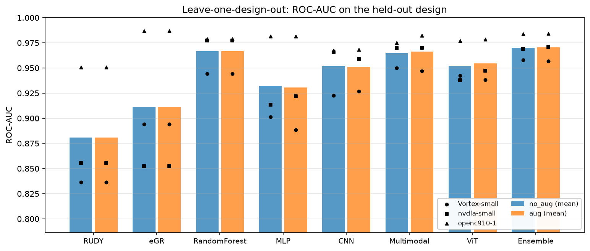

# RouteVision：晶片版圖繞線壅塞熱點預測（MMIP 期中 Milestone）

- **學生**：林孟霆（315833033），交大 平行運算系統實驗室
- **主題**：鑑別式 AI 系統。輸入 placement 後的版圖特徵圖，預測最終 global routing 後的繞線壅塞熱點，並和 EDA 工具內建的粗估（RUDY、early global routing）比較。

## 任務定義
| 項目 | 內容 |
| :--- | :--- |
| 資料 | CircuitNet-N14（BSD-3），使用 `routability_features` 中 3 個設計：Vortex-small（GPU）、nvdla-small（ML 加速器）、openc910-1（RISC-V CPU） |
| 輸入影像 | 4 通道 256×256：cell 密度、RUDY、腳位 RUDY、macro 區域（都在 placement 後就能取得） |
| 第二種模態 | 6 個設計參數（從檔名解析：`freq`、`mp`、`fpu`、`fpa`、`p`、`fi`）＋ 區塊位置 |
| 標註 | 最終 global routing 的繞線使用率（水平、垂直取大者） |
| 預測目標 | 版圖切成 8×8 個 32×32 區塊；區塊平均使用率 ≥ 0.6 為「熱點」。區塊分類模型看的是以該區塊為中心的 64×64 視窗（含周圍 16 格的上下文）；U-Net 則直接預測整張 256×256 使用率圖（逐像素回歸），再取區塊平均判斷熱點 |
| 切分 | **依設計切分**：Vortex-small 完全不參與訓練，作為測試；其餘兩個設計的版圖隨機分 85% 訓練、15% 驗證 |
| 評估 | ROC-AUC、PR-AUC、熱點 F1、Macro-F1、Precision、Recall；分類閾值一律在驗證集上決定 |

## 資料統計（實際前處理結果）
| 設計 | 類型 | 版圖數 | 原始大小（格） | 熱點比例（門檻 0.6） | 用途 |
| :--- | :--- | ---: | :---: | ---: | :--- |
| Vortex-small | GPU | 96 | 約 403×403 – 464×463 | 23.2% | **測試**（不參與訓練） |
| nvdla-small | ML 加速器 | 96 | 約 809×802 | 10.1% | 訓練／驗證 |
| openc910-1 | RISC-V CPU | 96 | 約 800×802 | 67.7% | 訓練／驗證 |

- 切分後：訓練 164 個版圖（10,496 個視窗）、驗證 28 個（1,792 個視窗）、測試 96 個（6,144 個視窗）。
- 每個設計的 96 個版圖來自 2（freq）× 2（mp）× 4（fpu）× 3（p）× 2（fi）＝ 96 種設計參數組合；`fpa` 在這三個設計中都固定為 1.0。
- **各設計的熱點比例差異很大**（10%–68%）：固定門檻在物理上有意義（使用率 ≥ 0.6 代表擁擠），但也代表測試設計的分布和訓練不同，這正是「能不能用在沒看過的晶片上」要面對的挑戰。
- **標註方向已驗證**：CircuitNet 文件把 utilization 寫成 remain tracks / total tracks，但實際資料顯示數值越高越擠。在 Vortex-small 抽 24 個版圖（約 400 萬個 tile）檢查：有 GR overflow 的 tile（占 0.95%）使用率全部是 1.0；使用率 < 0.6 的 tile 沒有任何 overflow；使用率和 RUDY 的相關係數為 0.40。因此「使用率 ≥ 0.6 為熱點」的方向正確。
- 前處理：`python -m routevision.prepare`。每個壓縮檔以串流方式讀取，只解碼需要的 8 種特徵圖並縮成 256×256（面積平均；macro 用最近鄰），結果約 35–45 MB／設計。

## 比較的方法
| 方法 | 說明 | 對應課程 |
| :--- | :--- | :--- |
| RUDY（EDA 粗估） | 直接用區塊平均 RUDY 當分數，不需學習 | baseline |
| eGR（EDA 粗估） | 直接用 early global routing 的區塊使用率當分數；只當比較對象，不當模型輸入 | baseline |
| OpenCV + Random Forest | 手工特徵（各通道統計量、Sobel 梯度、設計參數、位置） | Week 1–2 |
| MLP | 視窗縮成 32×32 後攤平 | Week 2 |
| CNN | 3 個卷積區塊，Grad-CAM 可視化 | Week 3 |
| Multimodal | CNN 影像分支 ＋ 設計參數 MLP 分支，串接後分類 | Week 2–3 |
| ViT | ImageNet ViT-B/16，patch embedding 改為 4 通道後微調 | Week 4 |
| U-Net | 編碼器為 ImageNet ResNet-18（4 通道），逐像素預測整張使用率圖，再取區塊平均當熱點分數；`U-Net (multimodal)` 另以 FiLM 加入設計參數（結果五） | Week 3、5、加分 |

## 結果一：跨設計驗證（leave-one-design-out，最主要的結果）
三個設計輪流當「完全沒參與訓練」的測試設計，在另外兩個設計上訓練（85% 訓練、15% 驗證）；閾值都在驗證集決定。下表為有資料增強的設定（`outputs/lodo/summary.csv`、`outputs/lodo/all_folds.csv`），每格是該設計當測試時的 ROC-AUC：

| 方法 | Vortex-small（GPU） | nvdla-small（ML 加速器） | openc910-1（RISC-V CPU） | **平均 ± 標準差** | Macro-F1 平均 | 逐張贏 eGR |
| :--- | ---: | ---: | ---: | ---: | ---: | ---: |
| 測試設計熱點比例 | 23.2% | 10.1% | 67.7% | | | |
| RUDY（EDA 粗估） | 0.836 | 0.856 | 0.951 | 0.881 ± 0.061 | 0.760 | 84 / 288 |
| eGR（EDA 粗估） | 0.894 | 0.852 | 0.987 | 0.911 ± 0.069 | 0.786 | （基準） |
| OpenCV + Random Forest | 0.944 | 0.977 | 0.979 | 0.967 ± 0.020 | 0.820 | 137 / 288 |
| MLP | 0.889 | 0.922 | 0.981 | 0.931 ± 0.047 | 0.804 | 141 / 288 |
| CNN | 0.927 | 0.959 | 0.968 | 0.951 ± 0.022 | 0.820 | 121 / 288 |
| Multimodal | 0.947 | 0.970 | 0.982 | 0.966 ± 0.018 | 0.865 | 163 / 288 |
| ViT | 0.938 | 0.947 | 0.978 | 0.955 ± 0.021 | 0.808 | 111 / 288 |
| Ensemble（RF + Multimodal + ViT） | 0.957 | 0.971 | 0.984 | 0.971 ± 0.014 | 0.838 | 132 / 288 |
| U-Net（逐像素，只用影像） | 0.948 | 0.974 | 0.988 | 0.970 ± 0.020 | 0.850 | 155 / 288 |
| **U-Net (multimodal)（逐像素＋設計參數）** | **0.969** | **0.988** | **0.994** | **0.984 ± 0.013** | **0.896** | **191 / 288** |



**觀察**
- **平均而言，學習方法在三個設計上都勝過兩個 EDA 粗估，而且更穩定**：學習方法的 ROC-AUC 標準差約 0.013–0.047，EDA 約 0.06–0.07。**最好的是 U-Net (multimodal)（0.984 ± 0.013），三個設計都是第一**；區塊分類方法中最好的是 Ensemble（0.971 ± 0.014）。U-Net 的結果見結果五（`outputs/unet/all_folds.csv`）。
- **優勢在「熱點少、難找」的設計最明顯**：nvdla-small（熱點 10%）上 eGR 只有 0.852（甚至低於 RUDY），學習方法 0.92–0.98；Vortex-small（23%）也一樣。
- **openc910-1 上 eGR 很強（0.987）**：這個設計 68% 的區塊都是熱點，壅塞到處都是，early global routing 就幾乎抓得到，所有區塊分類方法的 ROC-AUC 都沒有超過它；逐像素的兩個 U-Net 才超過（0.988、0.994）。以 Macro-F1 比較，Multimodal（0.918）、U-Net (multimodal)（0.933）都高於 eGR（0.905）。
- **多模態（影像 + 設計參數）在三個設計上都比純影像好**：區塊分類 Multimodal vs CNN（ROC-AUC 0.966 vs 0.951，Macro-F1 0.865 vs 0.820）；逐像素 U-Net (multimodal) vs U-Net（0.984 vs 0.970，Macro-F1 0.896 vs 0.850，逐張贏 eGR 191 vs 155）。
- **手工特徵 + Random Forest 一直很強**：ROC-AUC 平均 0.967、PR-AUC 平均 0.896（區塊分類方法中最高；U-Net (multimodal) 為 0.937）。特徵重要度前幾名都是 RUDY 相關特徵（`outputs/rf_feature_importance.csv`）。
- **ROC-AUC 高，但 F1 隨設計變動大**：測試設計的熱點比例（10%–68%）和驗證集（18%–47%）差很多，而閾值是在驗證集決定的。也就是說，模型「排出哪裡比較擠」的能力穩定，但「多擠才算熱點」的門檻需要依設計調整，這是未來工作。

## 結果二：資料增強（左右／上下鏡像）
| | 學習方法平均 ROC-AUC（3 設計） |
| :--- | ---: |
| 無增強 | 0.9536 |
| 有增強 | 0.9539 |

差距只有 0.0003，**鏡像增強對跨設計泛化沒有實質幫助**。Multimodal 逐張贏 eGR 的版圖數從 128 增為 163、Macro-F1 從 0.850 增為 0.865；ViT 則從 131 降為 111，整體互有增減。這表示泛化落差主要不是「版圖樣式不夠多」，比較可能來自設計之間的分布差異（熱點比例、macro 有無、縮放尺度，見下方「限制」）。依事先定好的規則（3 設計平均 ROC-AUC 較高者），網頁使用有增強的模型。

- 鏡像增強的正確性由 `tests/test_augment.py` 驗證：增強後的視窗與位置特徵，和「從鏡像後的整張版圖取對應區塊」完全相同；標註不變（水平線鏡像後仍是水平線）。
- 第一版（無增強）的模型與結果保留在 `checkpoints_v1/`、`outputs_v1/`。

## 結果三：網頁 demo 使用的模型（測試設計 Vortex-small，6,144 個視窗，熱點比例 23.2%）
即跨設計驗證中「Vortex-small 當測試、有增強」那一輪（`outputs/test_results.csv`）：

| 方法 | ROC-AUC | PR-AUC | F1（熱點） | Macro-F1 | Precision | Recall | Accuracy |
| :--- | ---: | ---: | ---: | ---: | ---: | ---: | ---: |
| RUDY（EDA 粗估） | 0.8364 | 0.4793 | 0.6062 | 0.7181 | 0.4921 | 0.7892 | 0.7625 |
| eGR（EDA 粗估） | 0.8942 | 0.6878 | 0.6489 | 0.7696 | 0.6318 | 0.6669 | 0.8328 |
| OpenCV + Random Forest | 0.9442 | 0.8422 | 0.7299 | 0.8096 | 0.6065 | **0.9164** | 0.8429 |
| MLP | 0.8885 | 0.6302 | 0.6681 | 0.7601 | 0.5351 | 0.8890 | 0.7954 |
| CNN | 0.9268 | 0.7580 | 0.6528 | 0.7830 | 0.7756 | 0.5636 | 0.8612 |
| Multimodal | 0.9468 | 0.7785 | 0.7664 | 0.8497 | 0.7988 | 0.7365 | 0.8960 |
| ViT | 0.9382 | 0.8232 | 0.6830 | 0.8014 | 0.8000 | 0.5959 | 0.8719 |
| Ensemble | 0.9569 | 0.8744 | 0.7785 | 0.8544 | 0.7546 | 0.8039 | 0.8940 |
| **U-Net (multimodal)** | **0.9692** | **0.9005** | **0.7932** | **0.8689** | **0.8773** | 0.7238 | **0.9126** |

圖表：`outputs/roc_pr_curves.png`、`outputs/hotspot_maps.png`、`outputs/gradcam_cnn.png`、`outputs/gradcam_multimodal.png`、`outputs/training_curves.png`；跨設計：`outputs/lodo/cross_design_roc_auc.png`、`outputs/lodo/cross_design_macro_f1.png`。

## 結果四：模型知道自己哪裡沒把握（不確定度）
`python -m routevision.uncertainty`，用三輪跨設計驗證存下的分數，不需重新訓練。**不確定度＝Ensemble 三個成員（RF、Multimodal、ViT）熱點機率的標準差**，推論時就能算，不需標註。對照組是最簡單的「離閾值遠近」（Ensemble 分數越接近閾值越不確定）。評估：用不確定度找出 Ensemble 判錯區塊的 AUROC，以及設計中最不確定的 20% 區塊涵蓋了多少錯誤（`outputs/uncertainty/uncertainty.csv`）。

| 測試設計 | Ensemble 錯誤率 | AUROC：模型間分歧 | AUROC：離閾值遠近 | 前 20% 涵蓋錯誤：分歧 | 前 20% 涵蓋錯誤：遠近 |
| :--- | ---: | ---: | ---: | ---: | ---: |
| Vortex-small | 10.6% | **0.869** | 0.843 | 67% | **71%** |
| nvdla-small | 6.0% | 0.930 | **0.937** | 90% | **95%** |
| openc910-1 | 17.7% | **0.933** | 0.613 | **75%** | 35% |
| **平均** | | **0.911** | 0.797 | **78%** | 67% |

- 只標出最沒把握的 20% 區塊，就涵蓋了平均 78% 的錯誤。
- 兩種方法在 Vortex-small、nvdla-small 差不多（「離閾值遠近」略好）；但在分布差最多的 openc910-1（68% 是熱點），「離閾值遠近」幾乎失效（0.613），模型間分歧仍有 0.933。原因是那裡的錯誤大多是「分數離閾值很遠、但閾值本身放錯」，單一分數看不出來，三個模型的意見分歧看得出來。
- 事先定好的另一個規則「不確定度高於驗證集的第 80 百分位」在新設計上標出了 23%–54% 的區塊（驗證集只有 20%），這些區塊包含 95%–98% 的錯誤；被標出的比例本身就反映模型在新設計上比在訓練設計上更沒把握。
- 網頁的「標出沒把握的區塊」：門檻為測試設計 Vortex-small 所有區塊中不確定度前 20%（只用沒標註的分數決定）。
- 圖：`outputs/uncertainty/risk_coverage.png`（依不確定度由低到高保留區塊時的錯誤率）。

## 結果五：U-Net 逐像素預測整張使用率圖
前面的方法都是「區塊是不是熱點」的分類。U-Net 直接預測 routing 後整張 256×256 的繞線使用率（監督式回歸，仍是鑑別式模型：用真實 routing 結果當標註，輸入 → 輸出，不產生新版圖），再取區塊平均當熱點分數，和其他方法放進同一張表（結果一）。

- **模型**（`routevision/models.py` 的 `UNet`、`routevision/pixel.py`）：編碼器為 ImageNet 預訓練 ResNet-18（第一層改成 4 通道，初始化方式同 ViT），解碼器為 U-Net 的上採樣＋跳躍連接，約 14.4 M 參數。`U-Net (multimodal)` 另把 6 個設計參數經 MLP 轉成每個通道的縮放與平移（FiLM），調整瓶頸層特徵；FiLM 初始為恆等。
- **訓練**：MSE、AdamW（lr 3e-4、OneCycle）、60 epochs、batch 8、左右／上下鏡像（輸入與標註一起鏡像），以驗證集 MSE 最低的 epoch 為準；切分與其他方法完全相同（匯出時檢查正規化參數與測試版圖順序一致）。Colab T4 每個模型約 2.3 分鐘（`notebooks/RouteVision_unet_executed.ipynb`）。
- **網頁使用的版本**：事先定好「三設計平均像素 Pearson 較高者」。兩者幾乎相同（0.8089 vs 0.8086），依規則選 `U-Net (multimodal)`。

**像素層級**（每張版圖分別計算再平均；eGR 本身就是使用率，可直接比；另外和用訓練設計做線性校正的 eGR、RUDY 比較；`outputs/unet/pixel_metrics.csv`）：

| 方法 | Vortex-small | nvdla-small | openc910-1 | **Pearson 平均** | SSIM 平均 | NRMSE 平均（越低越好） |
| :--- | ---: | ---: | ---: | ---: | ---: | ---: |
| U-Net | 0.728 | 0.811 | 0.886 | **0.809** | **0.453** | 0.165 |
| U-Net (multimodal) | 0.714 | 0.818 | 0.895 | **0.809** | **0.453** | **0.162** |
| eGR（原始值） | 0.588 | 0.541 | 0.825 | 0.651 | 0.243 | 0.335 |
| eGR（線性校正） | 0.593 | 0.541 | 0.825 | 0.653 | 0.285 | 0.203 |
| RUDY（線性校正） | 0.456 | 0.509 | 0.693 | 0.553 | 0.148 | 0.232 |

- **U-Net 預測的使用率圖比 eGR 更接近真實結果**：像素 Pearson 0.81 vs 0.65，SSIM 約為 eGR 的 1.9 倍，NRMSE 約減半；三個設計都成立。圖：`outputs/unet/<design>/maps.png`（輸入 RUDY、真實使用率、兩個 U-Net、eGR、校正後的 eGR 與 RUDY 並排）。
- **消融（設計參數）**：在像素層級幾乎沒有差別（Pearson 0.809 vs 0.809）；但在區塊熱點層級三個設計都較好（ROC-AUC 0.948→0.969、0.974→0.988、0.988→0.994；逐張贏 eGR 155→191 / 288）。可能的解釋是設計參數主要幫助判斷整體使用率的高低（熱點用固定門檻 0.6，需要絕對數值準確），而不是空間樣式（Pearson 不受整體縮放影響）；NRMSE 略低（0.165 vs 0.162）和這個解釋一致，但只有一次訓練，尚未進一步驗證。
- 這也回答「模型是否太小」：區塊分類的小 CNN（0.3 M）在同設計上已接近飽和，86 M 的 ViT 跨設計沒有更好；改成逐像素預測（14 M、用到整張圖的空間資訊）後，跨設計結果才明顯提升。
- **判斷依據**：U-Net 用 Seg-Grad-CAM（Vinogradova et al. 2020），目標為模型判為熱點的區塊內預測使用率的總和，取解碼器 32×32 那層（瓶頸層只有 8×8，和區塊格子一樣粗；更前面的編碼層會亮在版圖邊緣）（`routevision/gradcam.py` 的 `unet_cam`）。Random Forest、MLP、ViT 沒有卷積特徵圖，不適用 Grad-CAM。
- 正確性由 `tests/test_pixel.py` 驗證：Pearson／SSIM／NRMSE 在已知答案的圖上正確、線性校正、鏡像時輸入與標註一致、FiLM 初始為恆等。本機 CPU 推論的分數和 Colab 一致（區塊分數差 < 0.0005，來自混合精度）。

## 限制
- **只有 3 個設計**，跨設計的平均 ± 標準差只來自 3 個數字。
- **同設計驗證 vs 跨設計測試有落差**：深度模型在驗證集（和訓練同設計）上的 ROC-AUC 約 0.99，跨設計降到 0.89–0.98，代表模型部分學到了設計特有的樣式。
- **設計之間的分布差異**：熱點比例 10%–68%；nvdla-small、openc910-1 有 macro（約占面積 35%、15%），Vortex-small 全部 96 個版圖的 macro 通道都是 0；三個設計的原始大小不同（約 400–460 vs 800 格），都縮成 256×256 後，一個 32×32 區塊代表的實際面積差將近一倍。
- **每組實驗只訓練一次（seed 42）**，差距很小的比較（例如有無增強）不能視為顯著差異。

## 專案結構
```text
MMIP_project/
├── routevision/
│   ├── prepare.py        # 下載 CircuitNet 並串流前處理成 data/processed/<design>.npz
│   ├── dataset.py        # 熱點標籤、依設計切分、視窗資料集、正規化
│   ├── features.py       # OpenCV 手工特徵（Random Forest 用）
│   ├── models.py         # MLP、CNN、Multimodal、ViT、U-Net（ResNet-18 編碼器，可選 FiLM 設計參數）
│   ├── train.py          # 訓練（checkpoint 快取）、預測、評估指標、閾值
│   ├── gradcam.py        # Grad-CAM（單一視窗與整張版圖）
│   ├── experiments.py    # 完整實驗流程、輪流測試（leave-one-design-out）、集成與圖表
│   ├── uncertainty.py    # 不確定度：Ensemble 成員間的分歧（結果四）
│   └── pixel.py          # U-Net 逐像素預測：訓練、像素指標、輪流測試、匯出給網頁（結果五）
├── app/                               # 網頁 demo（Flask 後端 + HTML/CSS/JS 前端）
│   ├── server.py         # Flask：頁面與 REST API；啟動時在背景預先算好內建範例（磁碟快取 demo/cache/）
│   ├── inference.py      # 載入所有模型、推論、Grad-CAM、整體測試集統計（Flask 與 Streamlit 共用）
│   ├── make_demo_set.py  # 產生分組的內建範例 demo/demo_layouts.npz
│   ├── templates/index.html
│   ├── static/style.css, app.js   # 前端：即時分析／整體成效／方法與流程 三個頁面
│   ├── _old_ui/          # 改版前的網頁（備份）
│   └── streamlit_app.py  # 備用的 Streamlit 版本
├── tests/                # pytest：API（test_api.py）、鏡像增強（test_augment.py）、不確定度（test_uncertainty.py）、U-Net（test_pixel.py）
├── notebooks/
│   ├── RouteVision_train.ipynb         # 第一版：在 Colab T4 上訓練所有模型
│   ├── RouteVision_improve.ipynb       # 改進實驗：輪流測試 + 資料增強 + 集成
│   └── RouteVision_unet.ipynb          # U-Net 逐像素預測（三個設計輪流測試 × 兩個版本）
├── checkpoints/、outputs/、demo/       # 網頁使用的模型與結果（demo/sample_upload.npz 可用來示範上傳）
├── outputs/lodo/                       # 跨設計驗證：各輪結果、summary.csv、比較圖
├── outputs/uncertainty/                # 結果四的表格與圖
├── outputs/unet/、checkpoints_unet/    # 結果五：各輪結果、像素指標、預測圖；網頁用的 Vortex-small 那一輪模型
├── checkpoints_v1/、outputs_v1/        # 第一版（無增強）模型與結果
├── data/processed/                     # 前處理後的資料（已附）
└── slides/                             # 10/14 構想報告投影片
```

## 使用方式
1. **訓練（Colab）**：把 `RouteVision.zip` 上傳到 Google Drive 的 `MyDrive/`，在 Colab 開啟 `notebooks/RouteVision_train.ipynb`，選 T4 GPU 後全部執行。最後會下載 `RouteVision_results.zip`。
   改進實驗：上傳 `RouteVision_v2.zip`，執行 `notebooks/RouteVision_improve.ipynb`，下載 `RouteVision_results_v2.zip`。
   U-Net：上傳 `RouteVision_v3.zip`，執行 `notebooks/RouteVision_unet.ipynb`（約 20 分鐘），下載 `RouteVision_results_unet.zip`，解壓到專案後執行 `python -c "from routevision import pixel as P; P.export('Vortex-small')"` 匯出給網頁。
2. **網頁 demo（本機，CPU 即可）**：把 `RouteVision_results.zip` 解壓到這個資料夾（會產生 `checkpoints/`、`outputs/`、`demo/`），然後執行：
   ```bash
   conda create -n routevision python=3.11
   conda activate routevision
   pip install -r requirements.txt
   python app/server.py
   ```
   瀏覽器開啟 http://127.0.0.1:5000 。預設用 waitress（正式的 WSGI 伺服器；Flask 內建的開發伺服器在 Windows 上會偶發中斷連線），`--dev` 可改用開發伺服器。`scikit-learn` 需固定為 1.6.1（和 Colab 存 Random Forest 時的版本相同）。
   **報告前先開好 server**：ViT 在筆電 CPU 上每張版圖約需 20 秒，所以 server 啟動後會在背景把 7 個內建範例（所有方法＋Grad-CAM）先算好並存到 `demo/cache/`，左側範例旁的綠點代表已算好。第一次約 3 分鐘，之後重開 server 直接讀快取；重新訓練（checkpoint 改變）會自動重算。`--no-warm` 可關閉。
   備用版本：`streamlit run app/streamlit_app.py`。
3. **測試**：`python -m pytest tests -q`（30 項，約 1 分鐘）。
4. **不確定度分析**（CPU，幾秒）：`python -m routevision.uncertainty`，結果寫到 `outputs/uncertainty/`。

### 網頁介面
「即時分析」是四個步驟的故事，每一步都是三張圖並排（左：EDA 粗估或輸入、中：AI、右：真實結果），上方一句話結論：

| 步驟 | 三張圖 | 可調整 |
| :--- | :--- | :--- |
| 1 熱點預測 | eGR ↔ AI 方法 ↔ 真實熱點（抓到／誤報／漏掉） | AI 方法（預設為跨設計最好的方法） |
| 2 使用率圖 | eGR 使用率 ↔ U-Net 預測 ↔ 真實使用率（附像素 Pearson） | – |
| 3 可信度 | Ensemble 預測 ↔ 三個成員意見分歧（沒把握的區塊）↔ 真實熱點 | – |
| 4 判斷依據 | 輸入 RUDY ↔ Grad-CAM ↔ 真實熱點 | U-Net 多模態（預設）／CNN／Multimodal |

滑鼠移到任一區塊，三張圖同步標示並顯示該區塊的數值；「這張版圖上，所有方法的 F1」收在下方。「整體成效」：重點數字、跨設計點圖、U-Net 逐像素結果、不確定度，詳細表格可展開。「方法與流程」：系統流程、9 種方法、資料、架構。

鍵盤：`←` `→` 換步驟，`↑` `↓` 換版圖（報告時照步驟按就是 demo 流程）。直接開某一張、某一步：`http://127.0.0.1:5000/?demo=0&step=map`（step 為 hot／map／trust／why）；一般開啟網頁不會自動載入。Demo 上傳用的檔案在 `demo/upload_examples/`（說明見該資料夾的 README）。

**備用 demo 影片**：`demo/RouteVision_demo.mp4`（1080p、88 秒、無聲、附中文字幕），由 `demo/record_demo.py` 自動操作網頁錄製（需 server 在 port 5001 執行；Playwright＋系統 Edge＋imageio-ffmpeg）。網頁改動後重跑即可重錄。前一版介面備份在 `app/_old_ui/`。

### 內建範例（`demo/demo_layouts.npz`，由 `python app/make_demo_set.py` 產生）
分三組，並在網頁上標示組別；同一頁也顯示整體測試集的結果，避免以單一版圖代表整體表現：
| 組別 | 版圖 | 說明 |
| :--- | :--- | :--- |
| 測試設計｜模型表現好的例子 | Vortex-small 3 張 | 依 `outputs/test_scores.npz` 自動挑選：RF、Multimodal、ViT 中最差者的 F1 比 RUDY、eGR 中最好者高最多的版圖 |
| 測試設計｜eGR 比較準的例子 | Vortex-small 2 張 | eGR 的 F1 比 Multimodal 高最多的版圖 |
| 訓練設計的驗證版圖 | nvdla-small、openc910-1 各 1 張 | 同設計但該版圖沒參與訓練，有 macro（Vortex-small 沒有）；比測試設計容易，只供參考。依熱點數挑選，未參考模型表現 |

只挑熱點至少 8 個的版圖（熱點太少時 F1 雜訊太大），同一組設計參數只差 fi（ap／ar）的雙胞胎版圖只取一張。重新訓練後重跑腳本，組別標示會依新結果更新。原本隨機抽的 6 張測試版圖保留在 `demo/demo_layouts_random_seed0.npz`。

**整體測試集逐張比較**（網頁 demo 模型，Vortex-small 96 張；每張版圖各自算 F1，再和 eGR 比）：
| 方法 | 平均每張 F1 | 贏 eGR 的版圖 |
| :--- | ---: | ---: |
| eGR（EDA 粗估） | 0.640 | （基準） |
| RUDY（EDA 粗估） | 0.587 | 26 / 96 |
| OpenCV + Random Forest | 0.694 | 70 / 96 |
| MLP | 0.640 | 56 / 96 |
| CNN | 0.645 | 48 / 96 |
| Multimodal | 0.742 | 75 / 96 |
| ViT | 0.658 | 56 / 96 |
| Ensemble | 0.748 | 79 / 96 |
| U-Net (multimodal) | 0.763 | 82 / 96 |

單一版圖的 F1 雜訊很大（熱點少時差一格就差很多）；CNN 只和 eGR 互有勝負，加入設計參數（Multimodal）後才明顯拉開。

### 網頁 API（Flask）
| 方法 | 路徑 | 說明 |
| :--- | :--- | :--- |
| GET | `/` | 網頁 |
| GET | `/api/info` | 可用方法、說明、驗證集閾值、測試集指標、跨設計結果、內建範例（縮圖、是否已預先算好） |
| GET | `/api/status` | 已預先算好的內建範例 |
| POST | `/api/predict` | JSON `{"demo": k}` 或 multipart `file=<版圖 .npz>`；回傳 4 張輸入圖、每個方法的 8×8 熱點分數、真實熱點、各方法比較、不確定度、整張使用率圖（U-Net、eGR、RUDY、真實）與像素指標。同一版圖的結果會快取 |
| POST | `/api/gradcam` | JSON `{"layout_id": ..., "method": "CNN" 或 "Multimodal"}`；回傳 Grad-CAM 疊圖（`overlay`）與透明熱度圖層（`heat`） |

上傳格式：`.npz`，`X` 為 4×256×256（cell 密度、RUDY、腳位 RUDY、macro），`params` 為 6 個設計參數；`label`、`egr` 可省略（省略時不顯示真實熱點與 eGR）。檔案上限 20 MB，格式不符會回傳 400 與錯誤說明。

**驗證**：本機 CPU 推論的分數和 Colab 存下的 `outputs/test_scores.npz` 一致（RF、MLP、CNN、Multimodal 誤差 < 1e-6；ViT < 0.002、Ensemble < 0.001、U-Net < 0.0005，來自 GPU 混合精度與 CPU 的差異）。

## 目前進度與時程評估
**已完成**
- 構想報告投影片（`slides/RouteVision_期中構想報告_v3.pptx`）
- 資料下載與前處理（3 個設計，`data/processed/`）
- 全部程式：資料集與標籤、區塊分類 7 種方法＋U-Net 逐像素預測、訓練與評估、Grad-CAM、圖表、Colab notebook、網頁
- **Colab T4 訓練完成**，一次執行無錯誤（`notebooks/RouteVision_train_executed.ipynb`），結果見上方「結果」
- **改進實驗完成**（`notebooks/RouteVision_improve_executed.ipynb`）：三個設計輪流測試、有無資料增強、集成；網頁改用新模型並加入 Ensemble
- **網頁 demo 改為 Flask 後端 + HTML/CSS/JS 前端**（對應課程 Week 6 Flask 網頁開發）：所有方法皆可切換、Grad-CAM、比較表、上傳 .npz 皆已在本機測試；同一版圖的推論結果會快取，切換方法不需重算
- **10/24 網頁改版**：拆成三個頁面；EDA 粗估／AI／真實結果三張圖並排並同步滑鼠；內建範例啟動時預先算好（第一次分析從約 60 秒降到約 0.2 秒）；整體成效頁加入跨設計點圖
- **10/25 不確定度**（`routevision/uncertainty.py`，結果四）：模型間分歧找錯誤的 AUROC 平均 0.911（離閾值遠近 0.797）；網頁加入「標出沒把握的區塊」
- **10/25 U-Net 逐像素預測**（`routevision/pixel.py`，結果五，Colab T4）：像素 Pearson 0.81（eGR 0.65）；區塊熱點 ROC-AUC 0.984 ± 0.013，三個設計都是第一；網頁加入「使用率圖」模式

| 時間 | 工作 | 預估所需時間 |
| :--- | :--- | :--- |
| 10/13 前 | 上傳構想報告投影片 | 已完成 |
| 10/10 | 在 Colab 執行訓練 notebook | 已完成 |
| 10/12 | 在 Colab 執行改進實驗 notebook（輪流測試、資料增強、集成），更新結果 | 已完成 |
| 10/22–10/25 | 撰寫結果分析、製作 10/28 期中投影片與 demo 流程 | 1–2 天 |
| 10/25 | U-Net 逐像素預測（Colab） | 已完成 |
| 10/26–10/27 | 預留緩衝、錄製 demo 備用影片 | 1 天 |
| 期中後 | 期末 Agentic AI：LLM Agent、RAG 知識庫、Function Call、Guardrail | 約 1–2 週 |
